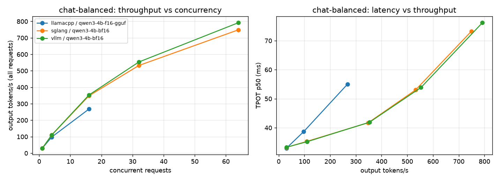
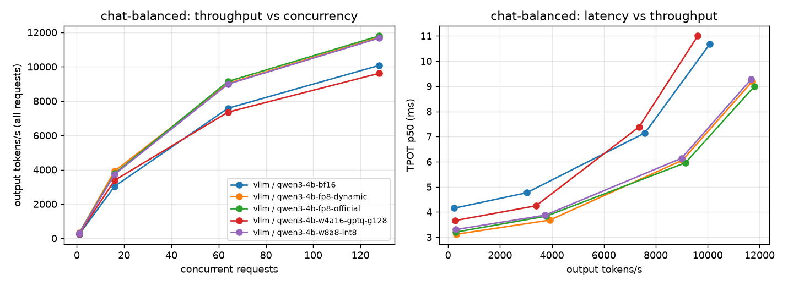
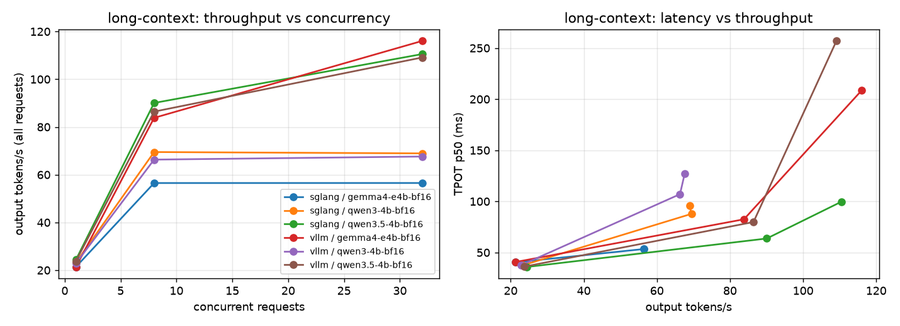
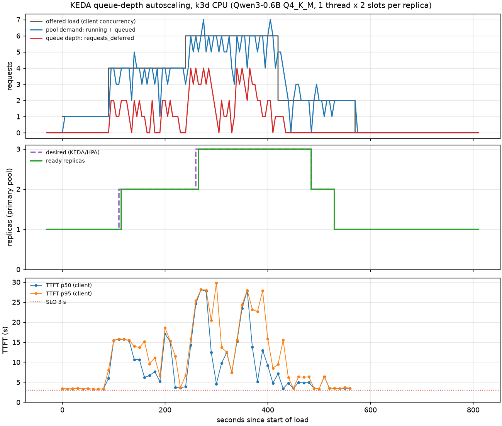
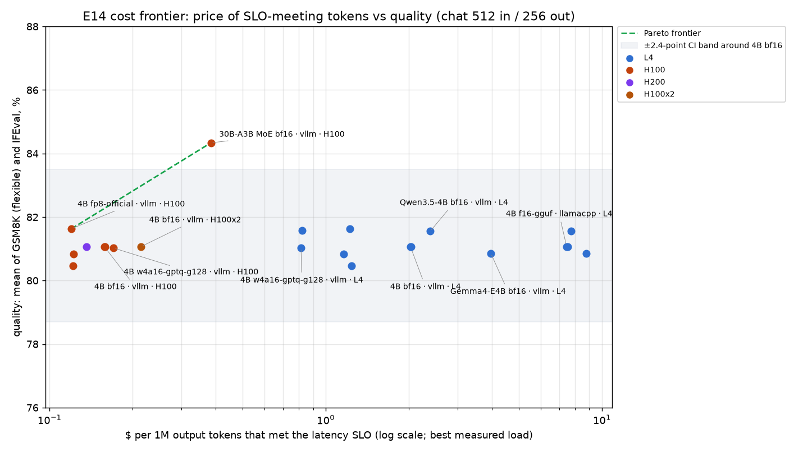
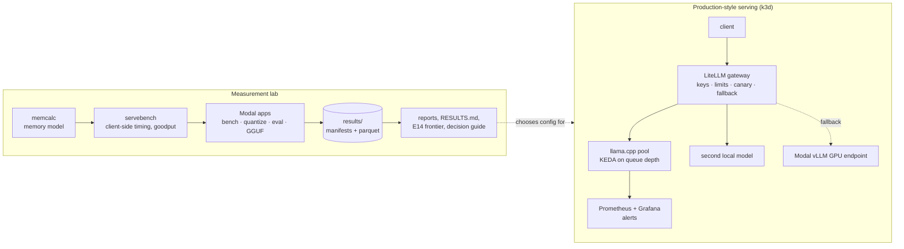

# Cortex Serve

> **Question:** for a given model, latency SLO and budget, which engine + quantization + configuration
> delivers the most goodput per dollar without unacceptable quality loss? Then run the winner as
> production-style serving the rest of Cortex can call.

Cortex Serve is a reproducible inference lab plus a production-style serving stack. It was built in milestones
M0–M7; every result below is reproducible from a committed config with a manifest (git SHA, image digest, model
revision, real GPU from `nvidia-smi`). Full tables: [`RESULTS.md`](RESULTS.md).

**Total GPU spend for M2–M5: ≈ $33 on Modal** (L4 $0.80/h, L40S $1.95/h, H100 $3.95/h).

---

## Results at a glance

### 1. Engines: vLLM vs SGLang vs llama.cpp (Qwen3-4B-Instruct-2507, bf16)

| GPU · concurrent users | vLLM tok/s | SGLang tok/s | llama.cpp tok/s | Users meeting the SLO* |
|---|---|---|---|---|
| L4 · 16 | 353 | 348 | 268 | ~4 |
| H100 · 64 | 7,271 | 7,345 | — | ~64 |

\*GPU SLO: TTFT p95 ≤ 500 ms and ≤ 50 ms per output token. **Per SLO-meeting request the H100 is ~12× cheaper than
the L4.** Single-user decode is identical on all three engines (33 ms/token on L4 = 80% of the memory-bandwidth ceiling).
Our client agrees with `vllm bench serve` within 1–7%.



### 2. Quantization: the GPU decides which format wins

| Format | Size | Quality vs bf16 | L4 ms/token (1 user) | H100 tok/s (128 users) |
|---|---|---|---|---|
| bf16 | 7.5 GiB | — | 33.3 | 10,079 |
| FP8 dynamic (ours, 18 s, data-free) | 4.1 GiB | no measurable loss | 21.1 | **11,710** |
| W8A8 INT8 | 4.1 GiB | no measurable loss | 20.8 | 11,673 |
| W4A16 GPTQ / AWQ | 2.5 GiB | PPL +5%, MMLU-Pro −2 | **12.2** | 9,619 |

On the bandwidth-poor L4, fewer bytes always win. On a busy H100 decode becomes compute-bound, weight-only INT4 has
to dequantize first, and real 8-bit compute wins (+30% goodput at 64 users):



Also measured: GGUF Q8/Q5/Q4 (KL divergence 0.0012 / 0.0115 / 0.0366; an importance matrix cuts 4-bit KLD 31%);
domain-only calibration (helps in-domain perplexity, hurts format-following); **QAT vs PTQ on Gemma 4 E4B**
(careful GPTQ ≈ Google's QAT ≈ bf16 on chat tasks; naive RTN −13.6 GSM8K).

### 3. Serving features (L4 unless stated)

| Experiment | Result |
|---|---|
| Prefix caching, 75% shared prompt | TTFT 3× faster; +73% throughput at 16 users; free for unique prompts |
| Chunked prefill | inter-token p99 365 → 47 ms with long prompts arriving |
| Speculative decoding, 0.6B draft | 1.27× faster at 1 user, gone at 16; n-gram 2% acceptance on chat |
| FP8 KV cache | 2× capacity, +46% long-context throughput, no measurable quality cost |
| MoE Qwen3-30B-A3B vs 4B dense (H100) | same single-user latency, half the batch throughput, +12 MMLU-Pro / +11 GSM8K |
| JSON-schema constrained output | 100% valid, ≤0.5% overhead |
| Tensor parallel, 2 × H100 | 1.37× faster tokens, −27% goodput per dollar |

**Architecture study (E15):** Qwen3-4B (dense) vs Qwen3.5-4B (hybrid Gated DeltaNet) vs Gemma 4 E4B (sliding window +
KV sharing + per-layer embeddings). Memory per 8K sequence: 1,152 vs 363 vs 309 MiB; long-context throughput at 32
users: 68 vs 109 vs 116 tok/s; Qwen3.5-4B matches or beats Qwen3-4B on quality.



### 4. Production-style serving (local k3d, CPU llama.cpp pods)

Helm chart, LiteLLM gateway (aliases, virtual keys, limits, retries, canary 90/10), KEDA autoscaling on queue depth,
Prometheus + Grafana with alert rules, NetworkPolicies, threat model. Measured: 630/630 requests ok across five
runs, two rolling updates under load with 0 failures, and **fallback to a Modal GPU endpoint**: with the CPU pool
down, 214 of 252 requests were served by the GPU (TTFT p50 0.27 s vs 5.96 s on CPU).



### 5. The cost frontier (E14) and the decision guide

Price of output tokens that met the SLO, at the best measured load, against quality. On an H100, FP8/INT8 weights cost
≈ $0.12 per 1M SLO-meeting tokens; the best L4 setup (4-bit) ≈ $0.81; L4 bf16 ≈ $2.0. All 4B variants sit inside the
quality CI band; only the 30B MoE buys more quality (≈ 3× the price per token).



→ **[`docs/DECISION_GUIDE.md`](docs/DECISION_GUIDE.md)**: which hardware, engine, format and settings to use, with a
decision flowchart and the evidence for each recommendation.

---

## Architecture



## What went wrong (and what it taught)

Each of these is documented with evidence in the milestone reports.

- **A feature that never ran (M1).** llama.cpp loaded the draft model but `--spec-type` defaults to `none`, so the first
  speculative-decoding run measured the baseline twice. servebench now fails any run whose draft model drafts nothing.
- **The cloud swapped the GPU (M2).** Modal served an H100 request on an H200; vLLM looked 20% faster than SGLang until
  rerun on a real H100. Every run now records and checks the GPU it got.
- **A "38-point maths collapse" was a format change (M3).** Reading raw answers showed the domain-calibrated model had
  stopped writing `#### N`; arithmetic dropped only 3 points. GSM8K is now reported strict and flexible.
- **A benchmark the baseline itself fails (M3).** Gemma 4's multiple-choice scores sat at chance even for bf16, so they
  measure nothing about quantization; Gemma is compared on generative tasks.
- **Tens of GB returned by mistake (M3).** A KL-divergence job tried to ship its reference logits back with its results;
  ≈ $2.40 wasted before it was caught.
- **Self-inflicted tooling bugs:** removed engine flags, missing processor files, a deadline guard that skipped every
  run, `pkill -f` matching its own shell. Each fixed with a test or a guard.
- **Access control applies to fallbacks (M5).** The first GPU-fallback demo routed nothing to the GPU because the API
  key's model allow-list didn't include it.

## What's inside

| Path | What it is |
|---|---|
| [`src/cortex_serve/memcalc/`](src/cortex_serve/memcalc/) | Per-layer memory model: weights from safetensors/GGUF headers, KV per layer type (full, sliding, shared, linear), max concurrency, decode ceilings |
| [`src/cortex_serve/servebench/`](src/cortex_serve/servebench/) | Benchmark harness: client-side TTFT/TPOT/ITL, closed-loop and Poisson load, goodput, real-prompt and JSON workloads, GPU/cgroup telemetry, Prometheus counters, manifests, reports |
| [`src/cortex_serve/quantize/`](src/cortex_serve/quantize/) | llm-compressor recipes, generic + BFSI calibration builders, model-card builder |
| [`src/cortex_serve/gatewaybench/`](src/cortex_serve/gatewaybench/) | Gateway load profiles, per-request outcome log, autoscaling timelines, canary gate |
| [`deploy/modal/`](deploy/modal/) | Modal apps: benchmarks (`bench_app`), quantization, lm-eval quality, GGUF track, GPU endpoint, HF publisher; all with spend guards |
| [`deploy/helm/cortex-serve/`](deploy/helm/cortex-serve/), [`deploy/k3d/`](deploy/k3d/), [`deploy/monitoring/`](deploy/monitoring/) | Production-style serving stack |
| [`configs/`](configs/) | Every benchmark config (CPU, GPU) |
| [`results/`](results/) | Run manifests, per-point parquet, quality results, reports and plots |

**Spend safety on paid GPUs** (`src/cortex_serve/spend.py`): every job has a hard timeout; a launch is refused if
Modal's metered spend + in-flight worst cases + its own worst case would cross the approved stage gate, or if
anything at all has been billed beyond credits; each run checks that the GPU it got is the GPU it asked for.

## Milestone reports

| Milestone | Report |
|---|---|
| M0 · Foundations, memcalc | [`docs/milestones/M0_REPORT.md`](docs/milestones/M0_REPORT.md) |
| M1 · servebench + CPU baseline | [`docs/milestones/M1_REPORT.md`](docs/milestones/M1_REPORT.md) |
| M2 · GPU engine baseline on Modal | [`docs/milestones/M2_REPORT.md`](docs/milestones/M2_REPORT.md) |
| M3 · Quantization + quality | [`docs/milestones/M3_REPORT.md`](docs/milestones/M3_REPORT.md) |
| M4 · Feature experiments | [`docs/milestones/M4_REPORT.md`](docs/milestones/M4_REPORT.md) |
| M5 · Production-style serving | [`docs/milestones/M5_REPORT.md`](docs/milestones/M5_REPORT.md) |
| M6 · Interactive web site | [`docs/milestones/M6_REPORT.md`](docs/milestones/M6_REPORT.md) |
| M7 · Cost frontier, decision guide, release | [`docs/milestones/M7_REPORT.md`](docs/milestones/M7_REPORT.md) |

Each report lists what was built, acceptance criteria, key numbers, deviations, decisions (marked ⚑), failures
caught, and an explain-back checklist. Decision IDs (D-0xx) refer to the project's internal decision log.

## Reproduce

```bash
make setup && make check                       # local: lint, types, 150+ tests

# memcalc (no downloads: reads safetensors headers with HTTP range requests)
uv run memcalc compare -m Qwen/Qwen3-4B-Instruct-2507 -m Qwen/Qwen3.5-4B --ctx 8192 --ctx 32768

# CPU benchmark (llama.cpp in Docker, pinned digest)
uv run servebench run serve/configs/cpu/e13_llamacpp.yaml --models-dir <gguf dir>

# GPU benchmarks on Modal (prints the worst-case cost; nothing runs without --yes)
uv run --extra modal modal run serve/deploy/modal/bench_app.py --config serve/configs/gpu/e1_l4_vllm.yaml
uv run --extra modal modal run serve/deploy/modal/quantize_app.py --recipe w4a16-gptq-g128 --calib generic
uv run --extra modal modal run serve/deploy/modal/eval_app.py --name qwen3-4b-bf16 --model Qwen/Qwen3-4B-Instruct-2507

# Reports and plots from run directories
uv run servebench report serve/results/e1-l4-*/*/ --out /tmp/report

# Local production stack (k3d, CPU)
make k3d-up && serve/scripts/m5_autoscale.sh && make k3d-down
```

## Models

Five Qwen3-4B-Instruct-2507 quantizations produced here (FP8-Dynamic, W8A8-INT8, W4A16-GPTQ, W4A16-AWQ, and a
BFSI-calibrated GPTQ research artifact) are prepared for Hugging Face under `intragalactic-stranger/` with model
cards built only from these results.

## Docs
- [`docs/learn/`](docs/learn/): 8 short learning docs on inference from first principles (model anatomy, memory math, roofline, serving techniques, quantization, formats, engines, lifecycle)
- [`docs/adr/`](docs/adr/): architecture decision records (monorepo, memory model, compute strategy, model lineup, measurement design, CPU tier, queue-depth autoscaling)
- [`docs/research/`](docs/research/): pre-milestone research notes (model selection, engines, Modal, quantization tooling)
- [`docs/THREAT_MODEL.md`](docs/THREAT_MODEL.md) · [`docs/VERSIONS.md`](docs/VERSIONS.md) · [`docs/SPEC.md`](docs/SPEC.md)

## memcalc example

```text
$ make demo
Memory per sequence and max concurrency on L4 (bf16 weights, auto KV)
 model              layers                        weights GiB  KV/token KiB  MiB/seq @8K  max seqs @8K  MiB/seq @32K  max seqs @32K
 Qwen3-4B-2507      36 full                              7.49         144.0        1,152             9         4,608              2
 Qwen3.5-4B         8 full, 24 linear                    7.83          32.0          305            36         1,073             10
 gemma-4-E4B-it     4 full, 20 sliding, 18 shared       14.00          16.0          148            32           532              9
```

memcalc matched vLLM exactly for the dense model and within −7% to +13% across seven engine/GPU/utilisation
settings; for the hybrid and sliding-window models vLLM allocates 6–109% more than the theoretical minimum (E15).
