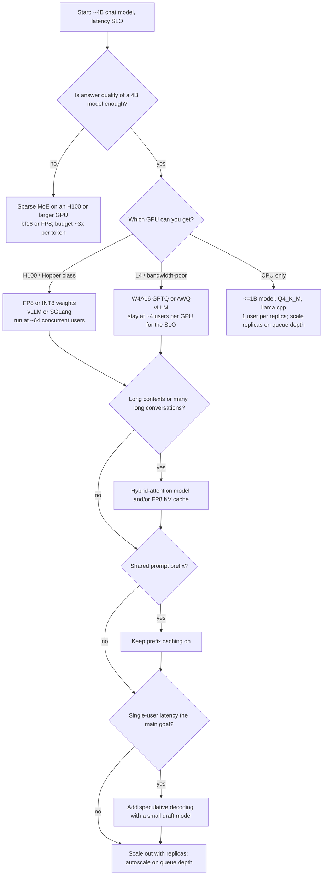

# Serving decision guide

**Which hardware, engine, format and settings should you use to serve a ~4B open model?** Every recommendation
below comes from a measurement in [`RESULTS.md`](../RESULTS.md); the section numbers point to the evidence.
Where we did not measure something, the guide says so.

**Scope.** Qwen3-4B-Instruct-2507 class models (plus one 30B MoE, Qwen3.5-4B and Gemma 4 E4B), vLLM 0.32.0, SGLang
0.5.22, llama.cpp b12110, Modal prices (L4 $0.80/h, H100 $3.95/h), chat traffic of 512 input / 256 output tokens
unless stated. **SLO** = first token ≤ 0.5 s at p95 and ≤ 50 ms per output token. **Goodput** = requests per
second that met the SLO. **Cost** = $ per 1M output tokens that met the SLO, at the best load we measured (E14).

---

## The short answer

| If you need… | Use | Why (evidence) |
|---|---|---|
| The lowest cost per useful token | **H100 + vLLM or SGLang + FP8 (or INT8) weights, ~64 concurrent users** | ≈ $0.12 per 1M SLO-meeting tokens, vs ≈ $0.81 for the best L4 setup and ≈ $2.0 for L4 bf16 (E14) |
| Only an L4 (or another bandwidth-poor GPU) | **4-bit weights (GPTQ or AWQ, W4A16)** | 2.7× faster per token at 1 user and 2.5× goodput at 4 users vs bf16; ≈ $0.81 per 1M (M3 §4, E14) |
| Better answers than a 4B model can give | **A sparse MoE (Qwen3-30B-A3B) on an H100** | +12.4 MMLU-Pro, +11 GSM8K at the same single-user speed, for ≈ 3× the cost per token (M4 E9, E14) |
| Long documents or long conversations | **A hybrid-attention model (Qwen3.5-4B) and/or FP8 KV cache** | 3× less KV per sequence; FP8 KV doubles capacity; 1.5–1.7× long-context throughput (M4 E15, E7) |
| Lowest latency for one user | **Speculative decoding with a small draft model** (and an H100 if you can) | 1.27× faster at 1 user; the gain is gone by 16 users (M4 E6) |
| A shared system prompt or shared documents | **Keep prefix caching on** (default in vLLM; RadixAttention in SGLang) | TTFT 3× faster, +73% throughput with 75% shared prompt; no cost when prompts are unique (M4 E4) |
| A second GPU for a model that fits on one | **Two replicas, not tensor parallel** | TP=2 is 1.37× faster per token but −27% goodput per dollar (M4 E12) |
| CPU only | **A ≤ 1B model, Q4_K_M, llama.cpp, one user per replica** | Only Qwen3-0.6B Q4_K_M at 1 user met the CPU SLO (TTFT ≤ 3 s, ≤ 125 ms/token) (M1, M5) |

## Decision flow

---

## 1. Hardware: price the tokens that meet the SLO, not the GPU hour

| Setup (best measured load) | $ per 1M SLO-meeting tokens | Quality (GSM8K flex + IFEval, mean) |
|---|---|---|
| H100 · vLLM · Qwen FP8 | **0.120** | 81.6 |
| H100 · vLLM · our FP8-dynamic / INT8 | 0.122 | 80.5 / 80.8 |
| H100 · vLLM or SGLang · bf16 | 0.158 | 81.1 |
| H100 · vLLM · W4A16 GPTQ | 0.170 | 81.0 |
| 2 × H100 · vLLM TP=2 · bf16 | 0.214 | 81.1 |
| H100 · vLLM · Qwen3-30B-A3B MoE bf16 | 0.384 | **84.3** |
| L4 · vLLM · W4A16 GPTQ / AWQ | 0.81–0.82 | 81.0 / 81.6 |
| L4 · vLLM · FP8 / INT8 | 1.16–1.24 | 80.5–81.6 |
| L4 · vLLM or SGLang · bf16 | 2.0 | 81.1 |
| L4 · llama.cpp · Q4_K_M (1 user) | 2.97 | not measured with this suite |
| CPU (t3a.xlarge) · llama.cpp · Qwen3-0.6B Q4_K_M (CPU SLO) | 3.3 | smaller model |

- **The H100 is ~5× the hourly price of an L4 and ~6–17× cheaper per SLO-meeting token**, because the L4's 33 ms
  single-user decode is already close to the 50 ms SLO: it meets the SLO for only ~4 chat users (M2 §1–2, E14).
- All 4B variants sit within ±2.4 points of each other on quality (inside the CIs), so **for a 4B model the choice
  is about cost and latency, not quality**. Only the MoE moves quality up.
- Plot: [`results/reports/m7-e14/frontier.png`](../results/reports/m7-e14/frontier.png).

## 2. Engine

- **vLLM and SGLang are interchangeable for dense models** on equal hardware: within ~5% on L4 and ~2% on H100
  (M2 §1–2). SGLang had slightly lower TTFT and higher goodput at 64–128 users on H100; vLLM slightly higher
  throughput on L4 at 64 users.
- **llama.cpp is 25–33% behind at 16 users** on a GPU (M2 §1). Use it for CPU and edge, or single-user GPU serving.
- **For new architectures, check engine support before choosing:** SGLang reached only 313 tok/s vs vLLM's 484 on
  Qwen3.5-4B with 32 chat users, and half of vLLM's throughput on Gemma 4 long contexts (E15).
- **Verify the hardware you got.** A cloud "H100" can be an H200 (Modal upgraded one of our requests). That one
  substitution made vLLM look 15–22% faster than SGLang (M2 §2).

## 3. Weight format (quantization)

| Format | Quality cost (vs bf16) | Best on |
|---|---|---|
| FP8 dynamic (W8A8) | none measurable | **H100 / Hopper**: +30% goodput at 64 users |
| INT8 (W8A8, SmoothQuant + GPTQ) | none measurable | Ampere and newer; same speed as FP8 here |
| W4A16 (GPTQ, AWQ) | perplexity +5%, MMLU-Pro −2 (inside CI) | **L4 / bandwidth-poor GPUs** at any load; H100 only at low concurrency |
| GGUF Q8_0 / Q5_K_M / Q4_K_M (+ imatrix) | KL divergence 0.001 / 0.012 / 0.037 (0.025 with imatrix) | llama.cpp: CPU, edge, Apple, single-user GPU |

- **On a busy H100, 4-bit weights are slower than bf16** (9,619 vs 10,079 tok/s at 128 users): weight-only INT4
  dequantizes before every matmul, which costs compute once the GPU is compute-bound (M3 §4).
- **Always use an importance matrix for 4-bit GGUF:** −31% KL divergence at the same size and speed (M3 §3).
- **Careful PTQ is enough:** GPTQ matched Google's quantization-aware-trained Gemma 4 checkpoint on chat tasks;
  naive round-to-nearest lost 13.6 GSM8K points (M3 §6). How you quantize matters more than whether the model was
  trained for it.
- **Calibrate on your domain mixed with general chat, not your domain alone:** domain-only calibration halved the
  in-domain perplexity damage but broke format-following (strict GSM8K −38, IFEval −3.9) (M3 §2).
- **Measure quantization damage against the same model's bf16 parent** (KL divergence), never perplexity across
  different checkpoints (M3 §5).

## 4. Memory settings

- **Give the KV cache enough memory for your concurrency, then stop:** at 50% GPU memory, throughput halved
  (requests queued); 70% and 90% were identical at 64 users (M2 §3).
- **`max_model_len` does not cost memory** in paged-attention engines; it only limits the longest request.
- **`max_num_seqs` trades per-user speed for total throughput:** capping at 8 gave 38 ms/token per user but a
  quarter of the throughput and 71 s waits (M2 §3).
- **Long contexts are KV-bound: FP8 KV cache** doubled capacity and gave +46% throughput on 7.7K-token prompts with no
  measurable quality cost on our (short-context) suite (M4 E7). Long-context retrieval quality under FP8 KV was not measured.
- memcalc predicts KV capacity within −7% to +13% for dense models; for sliding-window and hybrid models, engines
  use 6–109% more memory per sequence than the theoretical minimum (M2 §4, E15).

## 5. Serving features

| Feature | When it helps | When it doesn't |
|---|---|---|
| Prefix caching | Shared system prompts, RAG over the same documents: TTFT 3×, throughput +73% | Unique prompts (no cost either) |
| Chunked prefill | Long prompts arriving while others decode: inter-token p99 365 → 47 ms | When prefill fills every step (16 long-prompt users); tune the chunk size |
| Speculative decoding (draft model) | 1 user: 1.27× faster | 16 users: −6% throughput; doubles TTFT at 1 user |
| n-gram / prompt lookup | Edit, extract, quote-heavy outputs (not measured) | Open chat: 2% acceptance, −18% throughput at 16 users |
| JSON-schema constrained output | Always: ≤0.5% overhead | Valid JSON also came 100% from instructions alone; set `max_tokens` high enough (truncation was the real failure) |

## 6. Model architecture

- **Hybrid linear attention (Qwen3.5-4B)** gave 3× less KV per 8K sequence than dense Qwen3-4B, 2.9× more
  concurrent 8K sequences on an L4, 1.6× long-context throughput, and equal-or-better quality (E15).
- **Sliding window + KV sharing (Gemma 4 E4B)** also cut KV per sequence 3.7×, but its 14.5 GiB of weights (per-layer
  embeddings and vision/audio towers) leave only 4.2 GiB of KV on a 24 GB card. Check the weight footprint, not just
  KV per token (E15).
- **Sparse MoE (30B total, 3.3B active)** decodes almost as fast as a 4B dense model at one user (4.7 vs 4.2 ms/token)
  but at half the batch throughput: different requests route to different experts, so a busy batch reads most of
  the 30B weights (E9). Budget 7.5× the weight memory.

## 7. Scaling and operations

- **Second GPU:** replicas for throughput; tensor parallel only when latency is the constraint or the model does not
  fit on one GPU (E12).
- **Autoscale on queue depth, not CPU:** a CPU-utilisation autoscaler reacts to the wrong signal for LLM servers
  (ADR 0007). Queue-depth scaling followed load 1 → 3 → 1 replicas; average the metric (15 s) to avoid double-counting (M5).
- **Zero-downtime updates** need readiness probes that wait for the model, `maxUnavailable: 0` and a drain before
  stop: 127/127 requests succeeded across two rollouts under load (M5).
- **Gateway fallback works, but check permissions:** with the CPU pool down, 214/252 requests moved to a GPU
  endpoint; the first attempt sent zero there because the API key's model allow-list did not include the fallback
  model (M5 addendum).
- **Scale-to-zero GPU endpoints** cost nothing idle; budget a 2–3 minute cold start.

## 8. What this guide does not cover

Models larger than 30B; GPUs other than L4, L40S (quantization only), H100 and H200; multi-node serving; long-context
quality (> 8K) for quantized weights or FP8 KV; trained speculative heads (EAGLE/MTP); multi-LoRA serving; GPU
Kubernetes autoscaling (the k3d results are CPU). Prices are Modal's on 2026-11-24 and CPU is AWS on-demand list price.
