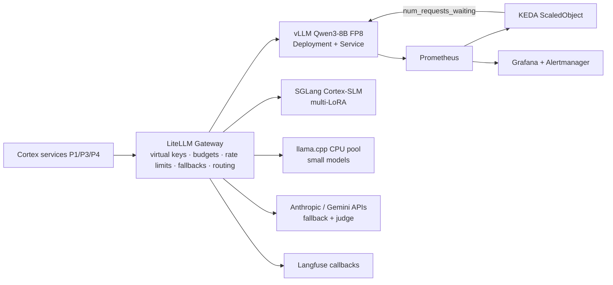

> **Copy of the original P2 spec** (`P2/02_CORTEX_SERVE_LLM_HOSTING_SPEC.md`), kept verbatim below.
> **Adaptations in force** (details in `adr/` and the implementation plan):
> - Compute: local CPU (AVX2-only EPYC, 15 GiB) + Modal GPUs within ~US$200 credits; no GKE/EKS GPU cluster (K8s shown on local k3d + a Modal GPU backend). See ADR 0003.
> - Models: primary **Qwen3-4B-Instruct-2507** (not Qwen3-8B); CPU tier Qwen3-0.6B / 1.7B / Gemma 4 E2B; MoE Qwen3-30B-A3B; new **E15 architecture study** (Qwen3-4B vs Qwen3.5-4B vs Gemma 4 E4B); Gemma 4 QAT vs PTQ added to E3. See ADR 0004.
> - memcalc models memory per layer (full / sliding / KV-shared / linear-attention state) and counts params from safetensors headers. See ADR 0002.
> - An interactive Next.js site on Vercel is added (browser memcalc + results explorer) as milestone M6; the decision guide moves to M7.

---

# Project 2 · Cortex Serve: LLM Inference Benchmarking, Quantization & Production Serving

> **Spec version:** 1.0 · **Owner:** Ganeshan Arumuganainar · **Part of:** Cortex (see `00_PORTFOLIO_ASSESSMENT_AND_ROADMAP.md`)
> **Build order:** first. **Consumed by:** P1 (generation, extraction, judges), P3 (agent models), P4 (fast generation for RL/eval; serving the trained SLM).
> **Note:** model training theory (pretraining, SFT, RLHF, distillation) lives in Project 4. This project covers *inference*: hosting, sizing, quantization, serving engines, and production operations.

---

## 0. Instructions for Claude Code

1. Read the whole spec. Work **one milestone at a time** (§13): plan, wait for approval, implement with tests, then update `RESULTS.md` and the ADRs.
2. Engines, models and flags change fast. **Before each milestone**, check the current stable versions and CLI flags of vLLM, SGLang, llama.cpp, Ollama and llm-compressor. Pin exact versions and container image digests in `docs/VERSIONS.md`. Never assume a flag exists; check `--help` output inside the container.
3. **GPU spend requires explicit approval.** Before any cloud GPU run, print: GPU type, provider, $/hr estimate, expected duration, total estimate. Automate teardown, and add an idle-timeout kill switch to every remote run.
4. Every benchmark run writes a manifest with engine version, image digest, model revision (HF commit SHA), quantization, GPU model, driver/CUDA version, all engine flags, workload config, git SHA and timestamp. No manifest means the result is invalid.
5. Standards: Python 3.12, `uv`, `ruff`, `mypy --strict`, `pytest`, `httpx` async, `pydantic` configs, `polars` or `pandas` + `pyarrow` for results, `matplotlib`/`plotly` for plots.

---

## 1. Storyline

> *"Teams pick an inference stack by vibes: 'vLLM is fast', 'just use Ollama', 'quantize to 4-bit'. But the right answer depends on workload shape, latency SLO, hardware and quality tolerance. I built a reproducible lab that answers: **for a given model, SLO and budget, which engine, quantization and configuration delivers the most goodput per dollar without unacceptable quality loss?** Then I deployed the winner as production serving on Kubernetes, with autoscaling, a multi-provider gateway and full observability."*

Two halves:
1. **Lab:** learning docs + memory calculator + benchmark harness + quantization pipeline + experiments → a published decision guide.
2. **Production:** a K8s serving platform (vLLM/SGLang behind a LiteLLM gateway) that the rest of Cortex uses.

---

## 2. Goals, Non-Goals, Success Criteria

### 2.1 Goals
- **G1** Learning docs that explain inference from first principles, with worked numeric examples (§3).
- **G2** `cortex-memcalc`: a CLI that sizes weights, KV cache, max concurrency and rough throughput for any HF model on any GPU.
- **G3** `servebench`: an engine-agnostic benchmark harness (OpenAI-compatible client) with reproducible manifests and an automated report.
- **G4** Your own quantized artifacts (AWQ, GPTQ, FP8, GGUF k-quants) published on Hugging Face with model cards and measured quality deltas.
- **G5** Experiment results across engines × quantization × workloads × concurrency × features.
- **G6** Production serving on K8s: autoscaling on queue depth, canaries, a gateway with fallbacks and budgets, dashboards and alerts.
- **G7** Decision guide + blog post.

### 2.2 Non-goals
- Writing CUDA kernels (that's stretch project B in the roadmap).
- Training models (P4).
- Benchmarking every engine in existence. TensorRT-LLM is **[OPTIONAL]**.

### 2.3 Success criteria
- Every number in `RESULTS.md` is reproducible from `make bench CONFIG=...` with a manifest.
- Throughput–latency curves for ≥3 engines on ≥2 GPU tiers, plus goodput under a stated SLO.
- Quality deltas for ≥5 quantization formats on ≥4 evals, plus a domain eval.
- K8s deployment autoscales from 1→N replicas on queue depth under a k6/servebench ramp, and back down, with no failed requests during a rolling update.
- `cortex-memcalc` predictions within ±10% of measured weight memory and within ±20% of the measured max concurrent sequences (document the gaps and why).

---

## 3. Learning Track (write these as `docs/learn/*.md` with worked examples)

Each doc: ≤2 pages, your own words, at least one worked numeric example, and "interview questions this answers".

1. **Model anatomy:** parameters, layers, hidden size, attention heads vs KV heads (MHA/MQA/GQA), head_dim, FFN (SwiGLU), vocab, context length, RoPE and RoPE scaling, tied embeddings. **MoE**: total vs active params (e.g. a 30B-total / ~3B-active model). Why MoE changes memory (all experts loaded) but not per-token compute (only active experts).
2. **Memory math:**
   - Weights ≈ `params × bytes_per_param` (bf16=2, fp8/int8=1, int4≈0.5 plus group-scale overhead).
   - **KV cache per token** = `2 × n_layers × n_kv_heads × head_dim × bytes`.
   - *Worked example (Llama-3.1-8B, bf16):* 32 layers, 8 KV heads, head_dim 128 → 2×32×8×128×2 = **131,072 B = 128 KiB/token** → 8K context ≈ **1 GiB per sequence**.
   - Show why GQA (8 KV heads vs 32) cuts the KV cache 4×, and why FP8 KV halves it again.
   - Activation memory and the CUDA graph/runtime overhead reserve.
3. **Compute & the roofline:**
   - Forward FLOPs ≈ `2 × params` per token.
   - **Prefill is compute-bound; decode is memory-bandwidth-bound.**
   - Single-stream decode ceiling ≈ `memory_bandwidth / bytes_of_weights_read_per_token`. *Example:* 8B bf16 ≈ 16 GB of weights. On a ~3.35 TB/s H100 that's ~200 tok/s upper bound; on a ~300 GB/s L4 it's ~19 tok/s. This is why quantization and batching matter, and why batching raises arithmetic intensity.
   - Define the latency metrics:
     - **TTFT**, time to first token
     - **TPOT/ITL**, time per output token / inter-token latency
     - **E2E**, end-to-end request latency
     - **throughput** and **goodput**, i.e. throughput of requests meeting the SLO
4. **Serving techniques:**
   - continuous batching
   - **PagedAttention** (KV blocks like OS virtual memory pages; connect this to the OS paging you study for interviews)
   - prefix caching (vLLM Automatic Prefix Caching vs SGLang **RadixAttention**)
   - chunked prefill
   - speculative decoding (draft model, n-gram/prompt-lookup, EAGLE-style heads; acceptance rate math)
   - disaggregated prefill/decode
   - tensor, pipeline and expert parallelism
   - structured/constrained decoding (grammar-based, e.g. XGrammar)
   - sampling parameters
   - multi-LoRA serving
5. **Quantization:**
   - Weight-only PTQ: GPTQ, AWQ, bitsandbytes NF4, GGUF k-quants with importance matrix.
   - Weight + activation: SmoothQuant W8A8, FP8 (E4M3) on Hopper/Ada.
   - KV cache quantization.
   - Microscaling formats (MXFP4/NVFP4).
   - QAT vs PTQ.
   - Why outlier channels make activation quantization hard.
   - Group size tradeoffs.
   - Which GPUs support which kernels.
6. **Formats & ecosystem:**
   - safetensors vs GGUF vs pickle (security)
   - HF repo layout (`config.json`, `tokenizer.json`, `generation_config.json`)
   - chat templates (Jinja), and why a wrong template silently tanks quality
   - licenses (Apache-2.0 vs Llama community license vs Gemma terms)
7. **Engine landscape:** vLLM, SGLang, llama.cpp (`llama-server`), Ollama (a llama.cpp-based developer UX), TensorRT-LLM, MLX (Apple), LM Studio. **When to use which:** data-center throughput vs edge/CPU vs developer laptop.
8. **The model lifecycle (overview; details in P4):** pretraining → midtraining → SFT → preference optimization/RL → distillation → quantization → serving. One page, linking to P4.

---

## 4. `cortex-memcalc` (Milestone 0 deliverable)

```bash
memcalc --model Qwen/Qwen3-8B --gpu L4 --dtype bf16 --kv-dtype fp8 --ctx 8192 --gpu-util 0.9
```

- Reads `config.json` from the HF Hub (or a local file). Handles GQA, MoE (`num_experts`, `num_experts_per_tok`) and tied embeddings.
- Outputs:
  - weight memory
  - KV per token and per sequence
  - free KV memory after weights and overhead
  - **max concurrent sequences** at the given context length
  - theoretical single-stream decode tok/s ceiling (bandwidth-bound)
  - prefill FLOPs per 1K tokens
- GPU table (`gpus.yaml`): VRAM, memory bandwidth, bf16/fp8 TFLOPS for T4, L4, A10G, A100-40/80, H100-80, H200, RTX 4090, Apple M-series (unified memory). Mark values as approximate and cite vendor spec pages.
- **Validation:** compare predictions against measurements from M2 (vLLM's reported KV cache capacity at startup) and report the error.

---

## 5. Models Under Test

> Verify the latest equivalents at build time. Prefer permissive licenses for anything you'll publish (Apache-2.0).

| Role | Model (example) | Why |
|---|---|---|
| Primary dense | **Qwen3-8B** (Apache-2.0) | Strong, permissive; also Cortex's default generator |
| Small dense | **Qwen3-1.7B** | Edge/CPU tier; P4 base-model family |
| MoE | **Qwen3-30B-A3B** | MoE memory/compute behavior |
| Comparison | Llama-3.1-8B-Instruct (license-gated) or Gemma-3-12B | Architecture comparison; check licenses |
| [OPTIONAL] | gpt-oss-20b (MXFP4 native) | Native 4-bit microscaling |
| Later | **Cortex-SLM** from P4 | Serve your own model, including multi-LoRA |

---

## 6. Hardware Tiers

| Tier | Hardware | Engines | Purpose |
|---|---|---|---|
| T0 Laptop/CPU | Your machine (CPU or Apple Silicon) | llama.cpp, Ollama | Edge story; dev loop |
| T1 Entry GPU | 1× L4 24 GB (or A10G 24 GB) | vLLM, SGLang, llama.cpp CUDA | Cost-efficient tier; where quantization matters most |
| T2 Datacenter GPU | 1× H100 80 GB (or A100 80 GB) | vLLM, SGLang, [OPTIONAL] TensorRT-LLM | FP8, MoE, high concurrency |
| T3 Multi-GPU [OPTIONAL] | 2× L4 or 2× H100 | vLLM/SGLang with TP=2 | Tensor-parallel scaling |

**Providers:** RunPod, Lambda, Modal, Vast.ai, or GCP/AWS spot instances. Write a provider-agnostic runner: a remote Docker host over SSH, or Modal functions.

---

## 7. Workloads & Datasets

| Workload | Source | Shape | Why |
|---|---|---|---|
| `chat-sharegpt` | ShareGPT V3 cleaned split (the standard vLLM benchmark dataset; verify the HF path) | Real conversational length distribution | Industry-comparable |
| `synthetic-short` | Generated | in 128 / out 128 | Latency floor |
| `synthetic-balanced` | Generated | in 512 / out 256 | Typical chat |
| `rag-long-prefill` | Generated or P1 traces | in 2,048–4,096 / out 128–256 | RAG: prefill-heavy |
| `long-context` | Generated | in 16K / out 256 | KV pressure |
| `shared-prefix` | Generated: one 2K-token system prompt + varied 100-token questions | Prefix reuse | Prefix caching / RadixAttention |
| `structured-json` | Prompts + JSON schema | out 200 | Constrained decoding overhead |
| `agent-multi-turn` [later] | P3 traces | Multi-turn, growing context | Real agent workload |

**Quality evals:**
- `lm-evaluation-harness`: MMLU-Pro (or an MMLU subset), GSM8K, IFEval, ARC-Challenge, HellaSwag.
- Perplexity on WikiText-2.
- **Domain eval:** 200 items from P1's gold set (answer correctness by a calibrated judge), or a placeholder set until P1 exists.
- **Format eval:** % valid JSON on the `structured-json` workload.

---

## 8. `servebench` Harness Design

```
servebench/
  engines/        # launchers: vllm.py, sglang.py, llamacpp.py, ollama.py, trtllm.py (optional)
                  #   each: build docker run cmd from config → start → wait /health → return base_url → stop
  workloads/      # dataset loaders + synthetic generators (seeded) → list[Request(prompt|messages, max_tokens, schema?)]
  client/         # async OpenAI-compatible streaming client (httpx); measures TTFT, ITL per token, E2E, tokens
  load/           # arrival patterns: fixed concurrency, Poisson rate, ramp; warmup phase
  collect/        # scrape engine /metrics (Prometheus text), nvidia-smi / DCGM sampler (util, mem, power)
  quality/        # wrappers for lm-eval-harness against the running server; judge eval; JSON validity
  report/         # parquet → plots + markdown tables; Pareto frontier
  manifest.py     # captures environment, versions, flags, hashes
  cli.py          # `servebench run configs/x.yaml`, `servebench sweep`, `servebench report`
```

**Measurement rules:**
1. Use client-side timing from the stream: TTFT = first content token; ITL = gaps between subsequent tokens.
2. Count output tokens with the model's tokenizer (not engine-reported) for cross-engine fairness, and also log the engine-reported count.
3. Warm up (≥50 requests or 60 s), then measure; 3 repeats per point; report the median and spread.
4. Use identical sampling across engines (`temperature=0` for latency runs, with a fixed `max_tokens` and `ignore_eos` where supported, so output lengths are equal). Document any engine that can't force the length.
5. **Goodput:** the fraction of requests meeting the SLO (default: TTFT p95 ≤ 500 ms *and* ITL p95 ≤ 50 ms), times throughput. Sweep the request rate to find **max goodput rate**.
6. **Cost:** `$/1M output tokens = ($/hr) / (output_tokens_per_hr / 1e6)` at the max-goodput operating point.
7. GPU telemetry: sample at 1 Hz and record peak memory, average utilization and power.
8. Cross-check: run the engines' own tools (`vllm bench serve`, GuideLLM, SGLang `bench_serving`, `llama-bench`) for ≥2 configs and confirm `servebench` agrees within ~5–10%. Explain any discrepancy.

**Config example:**

```yaml
# configs/vllm_qwen3_8b_l4_awq.yaml
engine: vllm
image: vllm/vllm-openai@sha256:<pin>
model: <your-hf-user>/Qwen3-8B-AWQ
revision: <commit-sha>
engine_args: {max_model_len: 8192, gpu_memory_utilization: 0.90, enable_prefix_caching: true, kv_cache_dtype: auto}
hardware: {gpu: L4, count: 1, provider: runpod}
workloads: [synthetic-balanced, rag-long-prefill, shared-prefix, chat-sharegpt]
load: {mode: concurrency, levels: [1, 4, 16, 32, 64, 128], duration_s: 120, warmup_s: 60}
slo: {ttft_p95_ms: 500, itl_p95_ms: 50}
repeats: 3
quality: {lm_eval_tasks: [gsm8k, ifeval, mmlu_pro], limit: null}
```

---

## 9. Quantization Pipeline

Produce your **own** artifacts (don't just download others') for Qwen3-8B, and for Qwen3-1.7B and Cortex-SLM later.

| Format | Tool | Target engine | Notes |
|---|---|---|---|
| BF16 baseline | — | all | Reference |
| FP8 dynamic (W8A8) | **llm-compressor** | vLLM / SGLang on H100/L4 (Ada supports FP8) | Near-lossless expected |
| INT8 W8A8 (SmoothQuant + GPTQ) | llm-compressor | vLLM | Calibrate on ~512 samples |
| INT4 W4A16 GPTQ | llm-compressor | vLLM / SGLang | Group size 128 |
| INT4 AWQ | llm-compressor AWQ modifier (AutoAWQ is deprecated; verify) | vLLM / SGLang | Compare with GPTQ |
| GGUF Q8_0, Q5_K_M, Q4_K_M, [OPTIONAL] IQ3/IQ2 | llama.cpp `convert_hf_to_gguf.py` + `llama-quantize` with **importance matrix** (`llama-imatrix`) | llama.cpp / Ollama | Compare imatrix vs not for Q4 |
| [OPTIONAL] bitsandbytes NF4 | bitsandbytes | HF / vLLM | QLoRA lineage (P4) |
| FP8 KV cache | engine flag | vLLM / SGLang | Orthogonal to weight quantization |

**Calibration data:** a mix of a generic text sample and your domain (P1 corpora) chunks. **Ablate:** generic vs domain calibration on the domain eval. This is an underexplored and interesting result.

**Publish:** each artifact goes to the HF Hub under your account, with a model card covering method, calibration data, recipe, eval deltas table, intended engine and license (inherit Apache-2.0 from Qwen).

**Quality report:** a table of format × eval (MMLU-Pro, GSM8K, IFEval, ARC-C, HellaSwag, WikiText-2 perplexity, domain judge score, JSON validity) with deltas vs BF16 and 95% CIs where the sample allows. Call out where 4-bit hurts (often reasoning/math and instruction following) vs where it doesn't.

---

## 10. Experiment Plan (the results matrix)

| Exp | Question | Design |
|---|---|---|
| E1 | Engine baseline | vLLM vs SGLang vs llama.cpp, BF16, Qwen3-8B, T1 + T2, all workloads, concurrency sweep → throughput–latency curves |
| E2 | Quantization speed | E1 grid × {BF16, FP8, W8A8, AWQ, GPTQ, GGUF Q4_K_M/Q8_0} on T1 and T2 |
| E3 | Quantization quality | §9 quality report |
| E4 | Prefix caching | `shared-prefix` + `rag-long-prefill`: APC on/off (vLLM) vs RadixAttention (SGLang); TTFT and throughput gains |
| E5 | Chunked prefill | Mixed long-prefill + short-decode traffic: ITL tail on/off |
| E6 | Speculative decoding | n-gram/prompt-lookup + a draft model (Qwen3-0.6B → 8B) + [OPTIONAL] EAGLE-style; measure acceptance rate and speedup **at low vs high concurrency** (gains often shrink at high batch: show it) |
| E7 | KV cache dtype | FP8 KV: max concurrency gain vs quality change on long-context |
| E8 | Memory knobs | `gpu_memory_utilization`, `max_num_seqs`, `max_model_len` effects; validate memcalc |
| E9 | MoE | Qwen3-30B-A3B vs Qwen3-8B on T2: memory, throughput, quality |
| E10 | Structured output | JSON schema-constrained vs unconstrained: overhead and validity |
| E11 | Multi-LoRA | Serve 1 base + N LoRA adapters (from P4) vs N merged models: memory and throughput |
| E12 [OPTIONAL] | Tensor parallel | TP=1 vs TP=2: scaling efficiency |
| E13 | CPU/edge | llama.cpp on your laptop: Q4_K_M vs Q8_0 on 1.7B and 8B; tokens/s, memory, quality |
| E14 | Cost frontier | Pareto plot: $/1M tokens vs quality score, across all configs meeting the SLO |

**Final artifact:** the **Decision Guide** (`docs/DECISION_GUIDE.md`), a flowchart plus table. Examples of the kind of conclusion it should reach *if* the data supports it:
- "Latency-sensitive RAG with shared prefixes on 1×L4 → engine X + FP8/AWQ + prefix caching."
- "Laptop/offline → llama.cpp Q4_K_M with imatrix."

Write only conclusions your data supports.

---

## 11. Production Serving on Kubernetes

### 11.1 Architecture



### 11.2 Requirements
1. **Model weights:** an init container downloads from HF (pinned revision) to a PVC or node-local cache, or you pre-bake to object storage. Don't download on every pod start. Measure cold-start time and optimize it (record the before/after).
2. **Probes:**
   - `startupProbe` with a generous threshold (model load takes minutes)
   - `readinessProbe` on `/health` (only after the model is loaded)
   - `livenessProbe`
3. **Resources:** `nvidia.com/gpu: 1`, GPU node pool taints/tolerations, appropriate shared memory (`/dev/shm` emptyDir for tensor parallel).
4. **Autoscaling:** KEDA (or a Prometheus-adapter HPA) on vLLM's waiting-requests metric (verify the current metric name) with min/max replicas, cooldowns, and documented reasoning on why CPU-based HPA is wrong for LLM serving. [OPTIONAL] Scale-to-zero for rarely used models, with cold-start cost documented.
5. **Rollouts:**
   - `maxUnavailable: 0`
   - PodDisruptionBudget
   - **canary** via gateway weighted routing (e.g. 90/10 between old and new model versions) with automated promotion if eval-on-traffic scores and error rates hold
6. **LiteLLM gateway:**
   - model aliases (`cortex-default`, `cortex-judge`, `cortex-router`)
   - per-service virtual keys with budgets and rate limits
   - fallbacks (self-hosted → API on 5xx or timeout)
   - retries with backoff
   - request timeouts
   - Langfuse logging
   - cost tracking
   - **Quality gates:** reuse your work pattern: don't route a model to production traffic unless its eval score is within X% of baseline.
7. **Observability:**
   - Scrape engine metrics: TTFT/ITL histograms, running/waiting requests, KV cache usage %, prefix cache hit rate, tokens/s.
   - DCGM exporter for GPU metrics.
   - Grafana dashboards committed as JSON.
   - **Alerts:** p95 TTFT above SLO for 5 minutes, KV cache usage >95%, error rate >1%, GPU down.
8. **Security:**
   - NetworkPolicies (only the gateway reaches model pods)
   - no public exposure of engine ports
   - API keys in Secrets (or External Secrets)
   - image digests pinned
   - non-root containers where supported
   - `--trust-remote-code` **off**
9. **Load test on the cluster:** a ramp from 1 to the target RPS. Show the autoscaling timeline (replicas over time vs queue depth vs TTFT) as a figure. **This is a showcase plot.**
10. **Environments:**
    - Local: **k3d/kind** with CPU-only llama.cpp deployments to validate all manifests, Helm values and the gateway.
    - Cloud: GKE or EKS with a GPU node pool via Terraform for the real run (time-boxed, then destroyed).
11. **[OPTIONAL] Advanced:** evaluate the vLLM production-stack / **llm-d** / KServe for prefix-aware routing across replicas (route requests sharing a prefix to the same replica). Measure the prefix-cache hit-rate gain.

### 11.3 Helm chart (`deploy/helm/cortex-serve`)
- Templated per-model deployments from `values.yaml`:

  ```yaml
  models:
    - name: qwen3-8b-fp8
      engine: vllm
      image: ...
      args: [...]
      gpu: 1
      replicas: {min: 1, max: 4}
      scaleMetric: waiting
  ```

- The gateway deployment, ServiceMonitors, PrometheusRules and Grafana dashboards are ConfigMaps.

---

## 12. Repository Layout

```
serve/
  README.md  RESULTS.md
  docs/ learn/*.md  DECISION_GUIDE.md  VERSIONS.md  adr/
  memcalc/                 # package + gpus.yaml + tests
  servebench/              # harness (see §8)
  quantize/                # recipes per format, calibration data builders, publish scripts
  configs/                 # benchmark configs and sweeps
  results/                 # parquet + manifests (gitignored raw; committed summaries)
  reports/                 # generated markdown + figures
  deploy/
    compose/               # local gateway + llama.cpp + Prometheus/Grafana
    helm/cortex-serve/
    terraform/{gke,eks}/
    grafana/ dashboards/*.json
    k6/                    # cluster load tests
  tests/
```

---

## 13. Milestones (≈6–8 weeks)

| # | Milestone | Acceptance criteria |
|---|---|---|
| M0 | Learning docs + memcalc | 8 docs in `docs/learn/`; memcalc CLI with tests; worked examples match hand calculations |
| M1 | Harness + local baseline | `servebench` runs against llama.cpp and Ollama on laptop/CPU; manifests; report generator; E13 done |
| M2 | GPU engine baseline | E1 on T1 (and T2 if budget allows); memcalc validation table; cross-check with native bench tools |
| M3 | Quantization artifacts + quality | All §9 formats produced, published to HF with cards; E2 + E3 complete |
| M4 | Feature experiments | E4–E10 (E11 after P4); plots and findings in `RESULTS.md` |
| M5 | Production on K8s | Helm + KEDA + LiteLLM gateway + dashboards + alerts on k3d (CPU) and one GPU cluster run with an autoscaling figure; canary rollout demo |
| M6 | Decision guide + blog | `DECISION_GUIDE.md`, E14 Pareto, README, blog post: *"Goodput per dollar: what actually matters when serving open LLMs"* |

---

## 14. Interview Talking Points

1. "Decode is memory-bandwidth-bound. Here's the arithmetic for 8B on an L4, and how batching and quantization move you along the roofline."
2. "I predicted KV capacity with my own calculator, and the error vs vLLM's real allocation was N%, because of X."
3. "Speculative decoding gave N× at concurrency 1 but only M× at 64. Here's why."
4. "Prefix caching cut RAG TTFT by N% because of a stable prompt-prefix ordering. That changed how I structured prompts in Cortex Retrieval."
5. "CPU-based HPA is wrong for LLM serving. I scaled on queue depth, and here's the timeline."
6. "Domain-calibrated AWQ beat generic calibration on my domain eval by N points (or didn't, and here's why)."

---

## 15. Risks

| Risk | Mitigation |
|---|---|
| GPU cost overrun | Approval gates, teardown automation, cheap-tier-first, budget tracker in `RESULTS.md` |
| Engine/version churn breaks flags | Pin image digests; capture `--help` per version |
| Unfair comparisons | Same tokenizer counting, same output lengths, same sampling, warmups, repeats, published configs |
| Quantization tool deprecation | Use llm-compressor as the primary path; record tool versions |
| GPU availability on spot | Provider-agnostic runner; retry on another provider |
