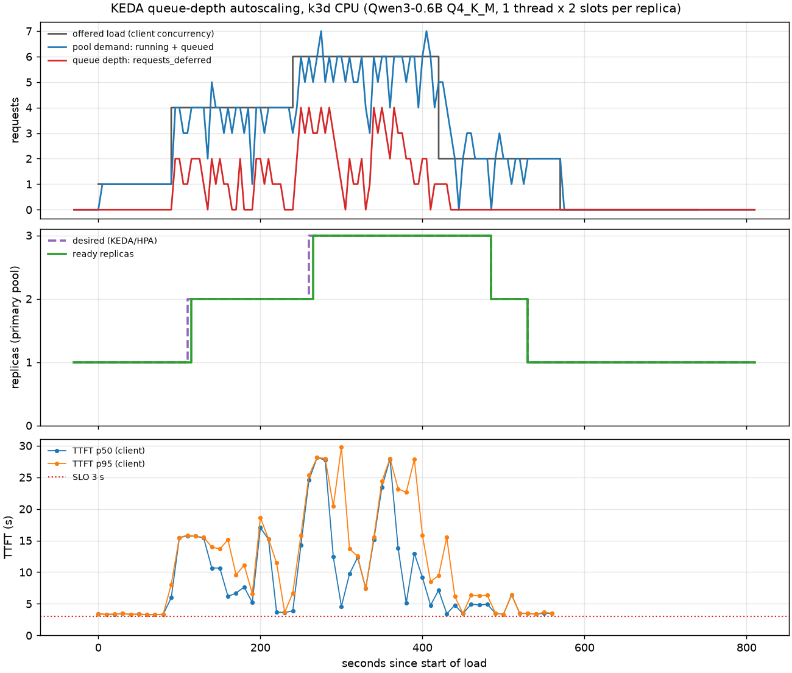
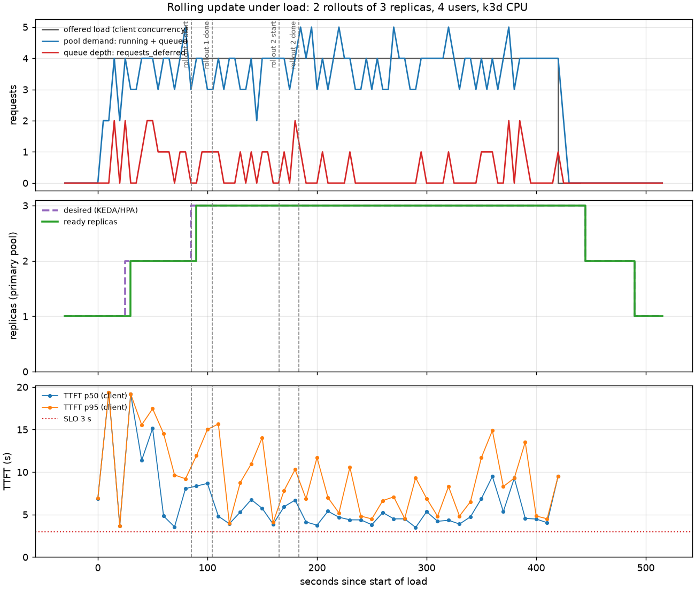

# M5 · Production-style serving on local k3d (CPU): Report

> **Status:** `DONE` with documented downscaling · **Date:** 2026-11-24 · **Branch:** `serve/m5-k3d` · **Paid compute:** $0 (all local, no Modal)
> **Results:** [`../../RESULTS.md`](../../RESULTS.md) §M5 · **ADR:** [`0007`](../adr/0007-queue-depth-autoscaling.md) · **Threat model:** [`../THREAT_MODEL.md`](../THREAT_MODEL.md)

GPU Kubernetes is deferred (G-13). Everything here runs on a **single-node k3d cluster** on the
4 vCPU (2 cores × 2 threads, AVX2) / 15 GiB AWS VM, with CPU llama.cpp pods. The gateway falls back to a
**second self-hosted model** (D-021), not to an external API.

## 1. Summary

| Deliverable | Status | Evidence |
|---|---|---|
| k3d cluster scripts; `make k3d-up` / `make k3d-down` | Done | `deploy/k3d/`; loopback-only ports, read-only GGUF mount |
| Helm chart: per-model Deployments from `values.yaml` (primary pool, canary, fallback) | Done | `deploy/helm/cortex-serve/`; `helm lint` / `helm template` clean; `make helm-check`; 9 render tests |
| Startup / readiness / liveness probes for slow loads; drain-aware `preStop` | Done | `templates/models.yaml`; §4.2 |
| Weights through a PV/PVC over a read-only hostPath cache | Done | `templates/weights.yaml`; create→Ready ≈ 6 s |
| PDB, `maxUnavailable: 0`, non-root, read-only rootfs, no SA token, seccomp | Done | chart + `tests/test_helm_chart.py` |
| NetworkPolicies: only the gateway (and Prometheus) reach model pods; model pods have no egress | Done, verified in-cluster (10/10 checks) | §4.4, `results/m5-netpol/` |
| LiteLLM gateway (pinned): `cortex-default`, `cortex-judge`, `cortex-router`; virtual keys with rpm + parallel limits and expiry; timeouts; retries; cooldowns | Done | `templates/gateway-config.yaml`, `scripts/m5_key.sh` |
| Fallback: k3d llama.cpp pool → second self-hosted model (D-021) | Done, demonstrated | §4.3, `results/m5-fallback/` |
| Disabled Modal vLLM slot (clearly marked; enters the chain and opens egress 443 only when enabled) | Done, not deployed | `values.yaml` `gateway.modal`; render tests |
| KEDA ScaledObject on queue depth + ADR on why CPU HPA is wrong | Done | ADR 0007 (with two amendments from measurements) |
| Prometheus + Grafana (trimmed kube-prometheus-stack), committed dashboard, 4 alert rules | Done | `dashboards/cortex-serve.json` (8 panels), `templates/alerts.yaml`; rules load healthy |
| Canary 90/10 with a documented promotion rule (error rate + latency + eval on both versions) | Done | §4.5, `results/m5-canary/` |
| Autoscaling timeline figure (replicas vs queue depth vs TTFT) | Done | §4.1, `results/m5-autoscale/*/timeline.png` |
| Rolling update under load, zero failed requests | Done | §4.2, `results/m5-rollout/` |
| `deploy/compose/` + `make up` | Written and `docker compose config`-validated; **not started** (disk) | §5 |
| Threat model | Done | `docs/THREAT_MODEL.md` |
| Tooling: `gatewaybench` (profile load, per-request outcome log, timeline, balance, pod lifecycle, canary gate) | Done | `src/cortex_serve/gatewaybench/`; 32 gatewaybench + 9 chart tests; `make check` green (147 passed) |

## 2. Acceptance criteria (plan M5)

| Criterion | Met? | Notes |
|---|---|---|
| Spec §11.2 items working on k3d: per-model Deployments, probes, PVC weights, PDB, `maxUnavailable: 0`, non-root, NetworkPolicies, gateway aliases, keys, limits, retries, fallbacks, KEDA, dashboards, alerts, canary | ✅ (CPU, one node) | Each item is in the chart and was exercised in a run, except Alertmanager routing (disabled) and Langfuse (optional, not done) |
| Autoscaling figure | ✅ | `results/m5-autoscale/20261124T135406Z/timeline.png` (final query); first ramp kept as evidence of the query bug |
| Zero-failure rollout log | ✅ | 127 / 127 requests ok over 2 full rollouts of a 3-replica pool, 0 gateway retries |
| Fallback demo | ✅ (self-hosted, D-021) | The plan's "Modal fallback demo" is replaced by the second in-cluster model. The Modal slot is written but disabled (no paid calls) |
| Threat model | ✅ | `docs/THREAT_MODEL.md` |
| G-04 CPU SLO under load | ❌ (expected) | Met only at 1 user (TTFT p50 3.3 s at 64 input tokens, 1 thread). §4.1 |

## 3. Key numbers (all measured on the k3d cluster, workload 64 in / 32 out, `cortex-router`)

| | Value | Source |
|---|---|---|
| Requests across the 5 load runs | **630, 0 failed** (1 request needed a gateway retry) | `results/m5-*/**/summary.json` |
| Pool size vs offered load (final query) | 1 user → 1 replica, 4 → 2, 6 → 3, 2 → back to 1 | `m5-autoscale/20261124T135406Z` |
| Scale-up reaction (load step → new replica Ready) | ≈ 20–25 s (≈ 20 s to the HPA decision + ≈ 6 s pod create→Ready) | same, timeline |
| Scale-down after load drops | first replica removed ≈ 65 s after the drop (60 s stabilisation) | same |
| Pod create → Ready (weights from the hostPath PVC) | ≈ 6 s (5–12 s, 5 s metric resolution) | `pods.json` in the rollout run |
| GGUF download from the Hub (for comparison, to /dev/null) | 2.2 s for 397 MB (183 MB/s) | one-off `curl` |
| Rolling update of 3 replicas under 4 users | ≈ 18–19 s per rollout, 0 failed, 0 retried | `m5-rollout/20261124T133518Z` |
| TTFT p50 / p95, 1 user (1 replica) | 3.33 s / 3.45 s | ramp stage 1 |
| TTFT p50 / p95, 6 users (3 replicas) | 12.2 s / 28.4 s (first ramp, with the over-scaling query: 7.9 s / 17.3 s) | ramp stage 3 |
| Pool decode throughput, 1 → 3 replicas | 5.0 → 8.9 tok/s (1.8×) | ramp stages 1 and 3 |
| Fallback: requests served while the primary was at 0 | 16 / 16, all marked `x-litellm-attempted-fallbacks: 1`; TTFT p50 14.5 s (1.7B on 2 threads) vs 5.2 s on the primary | `m5-fallback` |
| NetworkPolicy / auth checks | 10 / 10 pass | `m5-netpol` |
| Canary share observed (configured 10%) | 13 / 169 = 7.7% | `m5-canary` |
| Disk used by the cluster | ≈ 8.2 GB | `du` inside the node |

## 4. Evidence runs

All runs go through the gateway with a fresh virtual key (rpm 1,200, 32 parallel, 24 h expiry). Each run directory
has `manifest.json` (git SHA, image IDs that actually ran, chart values, node info), `outcomes.jsonl`
(one line per request: start time, TTFT, end-to-end, HTTP status, error, serving deployment, gateway retry/fallback
counters) and `summary.json`. Manifests at `0156efd` show `dirty: true` because the opt-in connection-close
edit was on disk but had not been deployed. The deployed chart was the one committed at `0156efd`.

### 4.1 Queue-depth autoscaling (`scripts/m5_autoscale.sh`)
Profile: 90 s × 1 user, 150 s × 4, 180 s × 6, 150 s × 2, 150 s idle.



| Stage | Users | Replicas | Requests | TTFT p50 / p95 (s) | Pool tok/s |
|---|---|---|---|---|---|
| 1 | 1 | 1 | 15 | 3.33 / 3.45 | 5.0 |
| 2 | 4 | 1 → 2 | 37 | 8.31 / 15.92 | 7.3 |
| 3 | 6 | 2 → 3 | 52 | 12.19 / 28.36 | 8.9 |
| 4 | 2 | 3 → 2 → 1 | 29 | 3.43 / 6.48 | 7.0 |

What it shows:
- Replicas follow demand / slots exactly (4 → 2, 6 → 3) and come back down. 133/133 requests ok.
- **More replicas did not bring TTFT back under the SLO**, for two measured reasons:
  1. *The CPU is shared.* 3 single-thread replicas on 2 physical cores give 1.8× the decode throughput of one, not 3×. Busy replicas were CPU-throttled in ~19% of CFS periods at their 1-core limit.
  2. *Load is uneven across replicas.* Queues persist at 3 replicas with 6 users (6 slots); see §7 item 7.
- The **first ramp** (`20261124T131550Z`) used the original query, which over-read 4 users as 5 and held 3 replicas for 4 users. It is kept as evidence for the ADR 0007 amendment.

### 4.2 Rolling update under load (`scripts/m5_rollout.sh`)
420 s at 4 users. Two `kubectl rollout restart`s of the primary pool (a new pod template, the same code path as an
image or args change) while KEDA held 3 replicas. Strategy `maxSurge 1 / maxUnavailable 0`; readiness-gated;
drain-aware `preStop`.



- **127 / 127 requests ok, 0 with a gateway retry.** Ready replicas never dropped below 3 during either rollout.
- Each rollout replaced 3 pods one by one in ≈ 18–19 s (each new pod Ready ≈ 6 s after creation).
- The rollout markers were derived afterwards from kube-state-metrics pod timestamps (5 s resolution), because the
  script's own markers were overwritten by a concurrent writer. The script was fixed (`events.log`).

### 4.3 Fallback to the second self-hosted model (`scripts/m5_fallback.sh`)
360 s at 2 users on `cortex-router` (no canary share). At t = 60 s the primary pool is paused at 0 replicas
(`autoscaling.keda.sh/paused-replicas=0`); after 150 s more it is restored.

| Phase | Served by | Requests | TTFT p50 | Failed |
|---|---|---|---|---|
| before / during drain | `cortex-router--primary-v1` | 30 | 5.2 s | 0 |
| primary gone | `cortex-fallback--fallback-v1` (Qwen3-1.7B Q4_K_M) | 16 | 14.5 s | 0 |

- **46 / 46 ok.** Every fallback response carries `x-litellm-attempted-fallbacks: 1`. When the primary came back, requests returned to it.
- **Finding:** the terminating primary pod kept serving for **≈ 120 s** after it was told to stop. The gateway's
  keep-alive connections to the pod survived endpoint removal, so new requests kept arriving and the drain hook
  (wait until idle) never saw idle. The pod exited when `terminationGracePeriodSeconds` = 120 s ran out, between
  two requests. No request was cut this time, but a kill mid-stream was possible. See §7 item 7 for the fix.
- With 0 pods the KEDA query returns no data. KEDA logged `ScaledObjectFallbackActivated`, and after the unpause scaled 0 → 1 as designed.

### 4.4 NetworkPolicies and backend auth (`scripts/m5_netpol_check.sh`, `results/m5-netpol/`)
10/10 PASS: an unlabelled pod (same namespace or `default`) cannot reach a model pod or the DB. The gateway
can reach `/health` (200) but gets 401 on `/v1/models` and `/metrics` without the backend key and 200 with it. The gateway
cannot reach the internet. A model pod can reach neither the internet nor the gateway.

### 4.5 Canary 90/10 and the promotion gate (`scripts/m5_canary.sh`)
600 s at 4 users on `cortex-default`, then the 20-question probe set on `cortex-stable` and `cortex-candidate`.

| | Stable (Q4_K_M, v1) | Candidate (Q8_0, v2) |
|---|---|---|
| Requests in window | 156 | 13 (7.7%) |
| Errors | 0 | 0 |
| TTFT p95 | 15.5 s | 6.7 s |
| Probe accuracy | 12 / 20 | 12 / 20 |

**Verdict: HOLD** (13 canary requests < the 20 required); weight left at 10%. The gate worked as designed:
it did not promote on thin evidence. Caveats, all visible in `decision.json`:
- The candidate's lower TTFT reflects its dedicated, less loaded pod, not a faster model.
- The probe scorer missed a correct "H₂O" (a Unicode subscript) for both versions.
- On this CPU box a decisive canary window needs ≥ 15 minutes at 4 users.

## 5. Deviations from the plan (and why)

| Plan item | What was done instead | Why |
|---|---|---|
| Fallback k3d pool → **Modal vLLM** → external API (G-08) | k3d pool → **second self-hosted model** (Qwen3-1.7B Q4_K_M). Modal slot written, disabled | D-021; no paid calls in M5 (another session supplies the URL) |
| GPU K8s autoscaling (spec §11.2) | k3d CPU, one node, max 3 replicas | G-13. The KEDA pattern carries over to vLLM's `num_requests_waiting` + `num_requests_running` (ADR 0007) |
| Workload `chat-short` 128/64 (M1) | **64 in / 32 out** | 1 decode thread per replica (so 3 replicas fit in 4 vCPUs). A 141-token prompt had TTFT p50 6.1 s at 1 user in a smoke test |
| G-04 SLO under load | Not met above 1 user; the TTFT alert would fire | The pool is CPU-bound on this box; M5's deliverable is the mechanism |
| Cold start "before and after the PVC cache" | Download time (2.2 s) vs create→Ready from cache (≈ 6 s) | No root, so no page-cache drop. Here the cache buys independence from the Hub (availability, rate limits, a no-egress policy) more than speed |
| Langfuse callbacks | Not done | Optional; another stateful service on a full disk |
| Alertmanager | Disabled; rules evaluate in Prometheus | No receivers on a laptop stack |
| `deploy/compose` | Written, `docker compose config` passes, **not started** | It would pull ~2 GB more images into the host Docker store; the k3d stack already used the ~8 GB budget |
| Automated promotion | The gate decides; the script applies `gateway.canary.weight` 100 / 0 via `helm upgrade`. Swapping the stable artifact stays a reviewed commit | A weight change is safe to automate; replacing the stable model is not |

## 6. Decisions (⚑ = made in this milestone without asking; proposed for `02_DECISIONS.md`)

- ⚑ **Single-node k3d without the load-balancer container; loopback-only ports** (`127.0.0.1:4000/9090/3300`, API `:6550`).
- ⚑ **1 thread × 2 slots per primary replica, max 3 replicas**: each replica adds real CPU until 3 of 4 vCPUs are used.
- ⚑ **Canary = same model at Q8_0; fallback = Qwen3-1.7B Q4_K_M; `cortex-judge` → 1.7B (falls back to `cortex-default`); `cortex-router` → primary pool only.**
- ⚑ **Scale on (running + queued) per slot**, as the 15 s mean of the summed series (ADR 0007, two amendments).
- ⚑ **Backend API key on every llama-server** on top of NetworkPolicies (defense in depth).
- ⚑ **Gateway `/metrics` unauthenticated**: LiteLLM 1.108 requires a proxy-admin key for it, and Prometheus should not hold admin (threat model T6).
- ⚑ **`--cache-ram 256`** on every llama-server after an OOM kill (§7).
- ⚑ **Connection-close to backends shipped opt-in (default off)** until it has been measured.
- ⚑ **Pins:** k3s v1.35.10, Helm v4.3.1, KEDA 2.21.1, kube-prometheus-stack 93.0.0 (newest older than two weeks), LiteLLM non-root v1.108.16.

## 7. Challenges and how they were solved

1. **Grafana 13 OOM-killed at 256 Mi** on first start → 640 Mi limit.
2. **k3d rejected port mappings without its LB container** → node-direct mappings (`server:0:direct`).
3. **LiteLLM `/metrics` is admin-only** (a scrape-only virtual key got 401) → unauthenticated metrics; decision §6.
4. **KEDA query over-read demand twice:** first a sum of two `max_over_time` terms double-counted requests moving queue→slot; then the peak of the sum still caught scrape-skew spikes. Both held 3 replicas for 4 users. Final form: 15 s mean (ADR 0007 amendments).
5. **OOM kill after ~100 min of load:** RSS 484 → 1,507 MiB against a 1,536 MiB limit. llama.cpp's host prompt cache defaults to **8,192 MiB** → `--cache-ram 256` plus a render test.
6. **Editing a running bash script killed a run** (bash reads scripts incrementally). The partial run was deleted and rerun; scripts are no longer edited while a chain uses them.
7. **Uneven load across replicas, and drains that never go idle.** The gateway keeps HTTP connections alive, and the ClusterIP Service balances per connection. In the 6-user stage of the first ramp, the newest pod averaged 2.84 requests in flight (0.88 queued) while another averaged 0.94 (`balance_260-415s.json`). The same pinning kept a terminating pod busy for its whole 120 s grace period (§4.3). Two fixes:
   - Candidate fix, in the chart and opt-in: `gateway.backendConnectionClose` sends `Connection: close`, so each request is balanced and a terminating pod stops receiving traffic.
   - Proper fix: queue-aware L7 routing (e.g. the Kubernetes Gateway API Inference Extension endpoint picker).
   **Not measured yet** (next item).
8. **Node disk pressure evicted the stack after the runs.** At 03:00 UTC on 11-25, after all evidence runs had finished, the shared VM's root filesystem crossed the kubelet eviction threshold. The node was tainted `disk-pressure` and every pod was evicted. This blocked the planned re-measurement with `backendConnectionClose=true`. On a shared, 85–94%-full disk the k3d stack (≈ 8.2 GB) is fragile. The evicted cluster was deleted afterwards (`make k3d-down`, plus the k3s / k3d-tools images) to give the disk back. `make k3d-up` rebuilds everything from the pinned versions in ~10 min.

## 8. Explain-back

**Readiness vs liveness vs startup probes for slow-loading models.**
- *Startup* covers the load phase. Until it succeeds, the other probes do not run. It gets a long budget (5 s × 60 = 5 min) because loading weights (mmap and warmup; on a GPU also transfer and graph capture) can take minutes. Without it, liveness would kill the pod in a restart loop.
- *Readiness* decides whether the pod is in the Service endpoints. It is quick (5 s × 2) so that a pod that stops answering stops getting new work. It must not fail just because the server is busy: llama.cpp's `/health` stays 200 with all slots full, so a saturated pod stays in rotation and the queue builds where KEDA can see it.
- *Liveness* restarts a hung process. A restart throws away in-flight work and the warm cache and forces a reload, so liveness is the most tolerant probe (20 s × 6, 10 s timeout). A CPU-saturated server is slow, not dead.
- On the way out, `preStop` waits for endpoint removal and then for the pod to go idle, within the 120 s grace period. §4.3 showed why the gateway's connection handling has to cooperate with this.

**Why queue depth?** Users feel TTFT, and TTFT grows with the number of requests waiting for a slot. CPU (or GPU) utilisation saturates as soon as one slot is busy and cannot see the queue. Scaling on (running + queued) / slots directly asks "how many replicas would serve everyone without waiting". The ramp shows replicas tracking demand 1 → 2 → 3 → 1 (ADR 0007).

**NetworkPolicy reasoning.** The gateway is the only place with authentication, per-key limits, logging and fallbacks. A direct path to a model pod bypasses all of them.
- Model pods accept TCP 8080 only from gateway pods and Prometheus, and they have no egress (nothing to call; nothing to exfiltrate to).
- Postgres accepts only the gateway. The gateway reaches only the model pods, Postgres and DNS.
- Policies are L4, so Prometheus could reach `/v1/*` on the scrape port. The backend API key closes that gap.
- Verified 10/10 with probe pods (§4.4).

**Canary promotion logic.** The candidate gets 10% of `cortex-default` through LiteLLM's weighted shuffle. Each response names the deployment that served it, so error rate and TTFT per version come from the same live window. The gate is a pure function (`canary.decide`, unit-tested):
- **HOLD** with too little canary evidence;
- **ROLLBACK** if the candidate's error rate is above max(1%, stable's), its TTFT p95 is above 1.25 × stable's, or its probe accuracy is more than 5 points below stable's;
- **PROMOTE** otherwise.
Comparing against stable in the same window keeps a shared incident from being blamed on the candidate. The verdict is applied as a gateway weight (100 / 0; HOLD keeps 10%). The M5 run ended in HOLD: 13 canary requests, below the minimum of 20.

## 9. Reproduce

```bash
make k3d-up                                   # cluster + KEDA + Prometheus/Grafana + chart (~10 min first time)
export CORTEX_API_KEY=$(serve/scripts/m5_key.sh)
serve/scripts/m5_autoscale.sh                 # ramp + timeline
serve/scripts/m5_rollout.sh 4 420             # rolling update under load
serve/scripts/m5_fallback.sh                  # primary down -> fallback model
serve/scripts/m5_netpol_check.sh              # policy checks
serve/scripts/m5_canary.sh 900 4 20           # canary window + gate (applies the verdict)
make k3d-down
```
