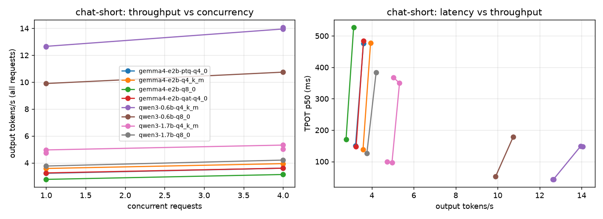

# M1 · E13 CPU tier (llama.cpp vs Ollama, 4 threads, EPYC 7571)

Sources: e13-cpu-llamacpp/20261105T061823Z, e13-cpu-ollama/20261105T081019Z

| Workload | Artifact | Engine | Conc. | Out tok/s (median [min-max]) | TTFT p50 / p95 (s) | TPOT p50 / p95 (ms) | SLO met | Goodput tok/s | Out tok/req | Peak RAM MiB | Reps | Err |
|---|---|---|---|---|---|---|---|---|---|---|---|---|
| chat-short | gemma4-e2b-ptq-q4_0 | llamacpp | 1 | 3.2 [3.2-3.2] | 10.36 / 10.43 | 150 / 157 | 0% | 0.0 | 64 | 1847 | 3 | 0 |
| chat-short | gemma4-e2b-ptq-q4_0 | llamacpp | 4 | 3.6 [3.6-3.6] | 40.80 / 41.54 | 476 / 480 | 0% | 0.0 | 64 | 1882 | 3 | 0 |
| chat-short | gemma4-e2b-q4_k_m | llamacpp | 1 | 3.6 [3.5-3.6] | 9.22 / 9.29 | 138 / 144 | 0% | 0.0 | 64 | 1736 | 3 | 0 |
| chat-short | gemma4-e2b-q4_k_m | llamacpp | 4 | 3.9 [3.9-3.9] | 34.95 / 35.10 | 477 / 481 | 0% | 0.0 | 64 | 1771 | 3 | 0 |
| chat-short | gemma4-e2b-q8_0 | llamacpp | 1 | 2.8 [2.6-2.8] | 12.06 / 12.44 | 170 / 194 | 0% | 0.0 | 64 | 657 | 3 | 0 |
| chat-short | gemma4-e2b-q8_0 | llamacpp | 4 | 3.1 [3.1-3.2] | 48.49 / 48.58 | 527 / 530 | 0% | 0.0 | 64 | 692 | 3 | 0 |
| chat-short | gemma4-e2b-qat-q4_0 | llamacpp | 1 | 3.2 [3.2-3.3] | 10.31 / 10.39 | 148 / 152 | 0% | 0.0 | 64 | 1656 | 3 | 0 |
| chat-short | gemma4-e2b-qat-q4_0 | llamacpp | 4 | 3.6 [3.6-3.6] | 40.44 / 40.54 | 485 / 490 | 0% | 0.0 | 64 | 1691 | 3 | 0 |
| chat-short | qwen3-0.6b-q4_k_m | llamacpp | 1 | 12.6 [12.3-12.6] | 2.35 / 2.38 | 43 / 47 | 100% | 12.6 | 64 | 2190 | 3 | 0 |
| chat-short | qwen3-0.6b-q4_k_m | ollama | 1 | 12.7 [12.6-12.7] | 2.33 / 2.36 | 43 / 44 | 100% | 12.7 | 64 | 3220 | 3 | 0 |
| chat-short | qwen3-0.6b-q4_k_m | ollama | 4 | 14.0 [13.9-14.0] | 8.98 / 8.99 | 149 / 149 | 0% | 0.0 | 64 | 3354 | 3 | 0 |
| chat-short | qwen3-0.6b-q4_k_m | llamacpp | 4 | 14.1 [13.8-14.1] | 8.95 / 9.00 | 147 / 147 | 0% | 0.0 | 64 | 2325 | 3 | 0 |
| chat-short | qwen3-0.6b-q8_0 | llamacpp | 1 | 9.9 [9.1-10.1] | 3.13 / 3.29 | 52 / 57 | 0% | 0.0 | 64 | 1974 | 3 | 0 |
| chat-short | qwen3-0.6b-q8_0 | llamacpp | 4 | 10.7 [10.5-11.1] | 12.65 / 13.17 | 179 / 184 | 0% | 0.0 | 64 | 2108 | 3 | 0 |
| chat-short | qwen3-1.7b-q4_k_m | llamacpp | 1 | 4.7 [4.4-5.0] | 7.02 / 7.33 | 100 / 115 | 0% | 0.0 | 64 | 2652 | 3 | 0 |
| chat-short | qwen3-1.7b-q4_k_m | ollama | 1 | 5.0 [4.9-5.0] | 6.74 / 6.99 | 96 / 100 | 0% | 0.0 | 64 | 4253 | 3 | 0 |
| chat-short | qwen3-1.7b-q4_k_m | ollama | 4 | 5.3 [5.3-5.3] | 26.10 / 26.25 | 350 / 350 | 0% | 0.0 | 64 | 4318 | 3 | 0 |
| chat-short | qwen3-1.7b-q4_k_m | llamacpp | 4 | 5.0 [5.0-5.2] | 27.33 / 27.61 | 368 / 372 | 0% | 0.0 | 64 | 2786 | 3 | 0 |
| chat-short | qwen3-1.7b-q8_0 | llamacpp | 1 | 3.8 [3.5-4.0] | 9.07 / 9.57 | 126 / 133 | 0% | 0.0 | 64 | 2002 | 3 | 0 |
| chat-short | qwen3-1.7b-q8_0 | llamacpp | 4 | 4.2 [3.9-4.3] | 36.77 / 37.20 | 383 / 387 | 0% | 0.0 | 64 | 2137 | 3 | 0 |

