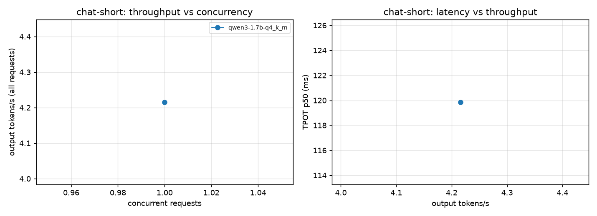

# M1 · E6 CPU preview: speculative decoding

Sources: e6-cpu-baseline/20261116T072042Z, e6-cpu-spec-decoding/20261116T072642Z

| Workload | Artifact | Engine | Conc. | Out tok/s (median [min-max]) | TTFT p50 / p95 (s) | TPOT p50 / p95 (ms) | SLO met | Goodput tok/s | Out tok/req | Peak RAM MiB | Reps | Err |
|---|---|---|---|---|---|---|---|---|---|---|---|---|
| chat-short | qwen3-1.7b-q4_k_m | llamacpp | 1 | 4.2 [3.4-5.0] | 8.02 / 8.20 | 120 / 127 | 0% | 0.0 | 64 | 2600 | 6 | 0 |

