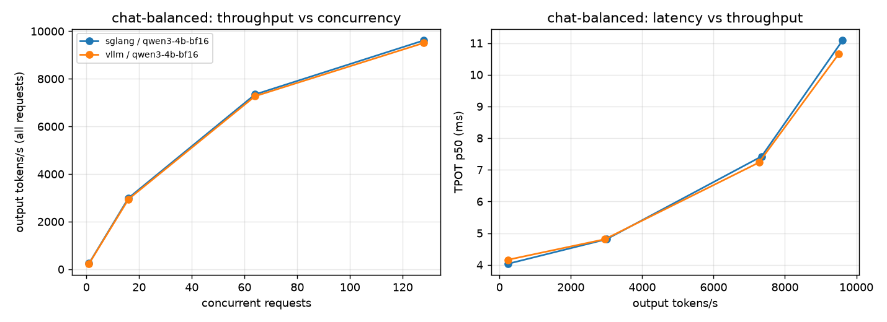
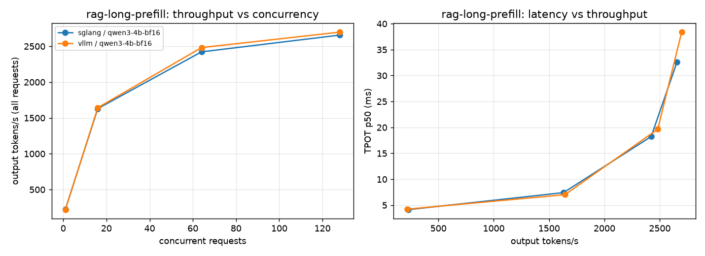

# M2 E1: vLLM vs SGLang on H100 80GB (exact type)

Sources: serve/results/e1-h100-vllm/20261124T093644Z, serve/results/e1-h100-sglang/20261124T082621Z

| Workload | Artifact | Engine | Conc. | Out tok/s (median [min-max]) | TTFT p50 / p95 (s) | TPOT p50 / p95 (ms) | SLO met | Goodput tok/s | Out tok/req | Peak mem MiB | Reps | Err |
|---|---|---|---|---|---|---|---|---|---|---|---|---|
| chat-balanced | qwen3-4b-bf16 | vllm | 1 | 231.7 [230.3-232.3] | 0.04 / 0.05 | 4 / 4 | 100% | 231.7 | 256 | 73989 | 3 | 0 |
| chat-balanced | qwen3-4b-bf16 | sglang | 1 | 244.0 [243.9-244.1] | 0.02 / 0.02 | 4 / 4 | 100% | 244.0 | 256 | 70888 | 3 | 0 |
| chat-balanced | qwen3-4b-bf16 | sglang | 16 | 2994.5 [2853.8-3004.6] | 0.14 / 0.15 | 5 / 5 | 100% | 2994.5 | 256 | 70888 | 3 | 0 |
| chat-balanced | qwen3-4b-bf16 | vllm | 16 | 2946.9 [2932.6-2969.2] | 0.16 / 0.17 | 5 / 5 | 100% | 2946.9 | 256 | 73989 | 3 | 0 |
| chat-balanced | qwen3-4b-bf16 | sglang | 64 | 7345.4 [7165.3-7364.3] | 0.34 / 0.51 | 7 / 8 | 94% | 6924.6 | 256 | 70888 | 3 | 0 |
| chat-balanced | qwen3-4b-bf16 | vllm | 64 | 7271.1 [7255.0-7308.6] | 0.37 / 0.58 | 7 / 8 | 84% | 6135.0 | 256 | 73989 | 3 | 0 |
| chat-balanced | qwen3-4b-bf16 | vllm | 128 | 9507.8 [9482.7-9572.3] | 0.69 / 1.07 | 11 / 12 | 29% | 2716.4 | 256 | 73989 | 3 | 0 |
| chat-balanced | qwen3-4b-bf16 | sglang | 128 | 9614.4 [9532.9-9653.2] | 0.57 / 0.93 | 11 / 12 | 39% | 3745.6 | 256 | 70888 | 3 | 0 |
| rag-long-prefill | qwen3-4b-bf16 | vllm | 1 | 219.3 [219.2-219.7] | 0.05 / 0.05 | 4 / 4 | 100% | 219.3 | 128 | 73989 | 3 | 0 |
| rag-long-prefill | qwen3-4b-bf16 | sglang | 1 | 225.2 [225.1-225.4] | 0.04 / 0.04 | 4 / 4 | 100% | 225.2 | 128 | 70888 | 3 | 0 |
| rag-long-prefill | qwen3-4b-bf16 | vllm | 16 | 1642.9 [1628.3-1646.1] | 0.35 / 0.51 | 7 / 9 | 92% | 1506.0 | 128 | 73989 | 3 | 0 |
| rag-long-prefill | qwen3-4b-bf16 | sglang | 16 | 1630.5 [1627.3-1630.7] | 0.31 / 0.49 | 7 / 9 | 100% | 1630.5 | 128 | 70888 | 3 | 0 |
| rag-long-prefill | qwen3-4b-bf16 | sglang | 64 | 2422.1 [2419.7-2447.8] | 1.04 / 1.83 | 18 / 25 | 19% | 459.0 | 128 | 70888 | 3 | 0 |
| rag-long-prefill | qwen3-4b-bf16 | vllm | 64 | 2481.6 [2481.5-2496.6] | 0.73 / 1.78 | 20 / 24 | 19% | 465.3 | 128 | 73989 | 3 | 0 |
| rag-long-prefill | qwen3-4b-bf16 | vllm | 128 | 2697.7 [2693.5-2699.4] | 1.18 / 3.62 | 38 / 43 | 7% | 182.4 | 128 | 73989 | 3 | 0 |
| rag-long-prefill | qwen3-4b-bf16 | sglang | 128 | 2656.3 [2653.3-2662.3] | 1.99 / 3.61 | 33 / 46 | 10% | 256.5 | 128 | 70888 | 3 | 0 |

