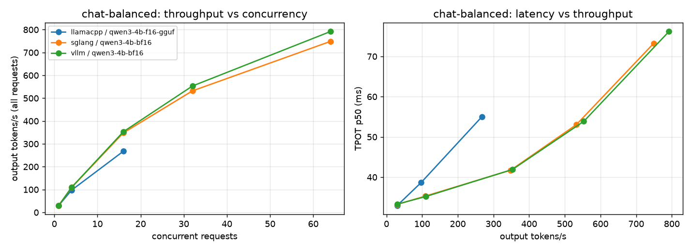
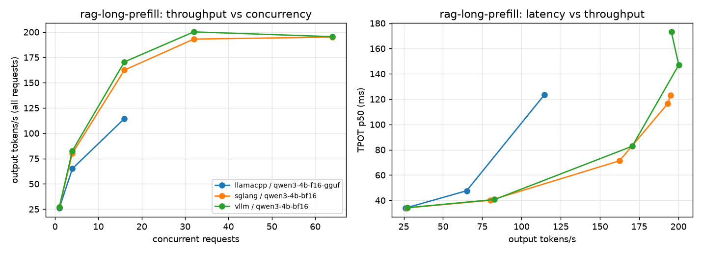

# M2 E1: three engines on L4 (Qwen3-4B-Instruct-2507)

Sources: serve/results/e1-l4-llamacpp/20261124T091031Z, serve/results/e1-l4-sglang/20261124T072459Z, serve/results/e1-l4-vllm/20261124T064135Z

| Workload | Artifact | Engine | Conc. | Out tok/s (median [min-max]) | TTFT p50 / p95 (s) | TPOT p50 / p95 (ms) | SLO met | Goodput tok/s | Out tok/req | Peak mem MiB | Reps | Err |
|---|---|---|---|---|---|---|---|---|---|---|---|---|
| chat-balanced | qwen3-4b-bf16 | vllm | 1 | 29.8 [29.8-29.8] | 0.10 / 0.11 | 33 / 33 | 100% | 29.8 | 256 | 20163 | 3 | 0 |
| chat-balanced | qwen3-4b-bf16 | sglang | 1 | 29.8 [29.8-29.8] | 0.11 / 0.12 | 33 / 33 | 100% | 29.8 | 256 | 21227 | 3 | 0 |
| chat-balanced | qwen3-4b-bf16 | vllm | 4 | 109.7 [109.7-109.8] | 0.36 / 0.37 | 35 / 36 | 100% | 109.7 | 256 | 20163 | 3 | 0 |
| chat-balanced | qwen3-4b-bf16 | sglang | 4 | 109.0 [109.0-109.1] | 0.39 / 0.39 | 35 / 36 | 100% | 109.0 | 256 | 21227 | 3 | 0 |
| chat-balanced | qwen3-4b-bf16 | vllm | 16 | 353.2 [353.1-353.4] | 0.83 / 1.30 | 42 / 44 | 25% | 88.3 | 256 | 20163 | 3 | 0 |
| chat-balanced | qwen3-4b-bf16 | sglang | 16 | 348.2 [346.7-349.0] | 1.11 / 1.44 | 42 / 45 | 6% | 21.8 | 256 | 21227 | 3 | 0 |
| chat-balanced | qwen3-4b-bf16 | vllm | 32 | 553.3 [552.3-556.5] | 0.94 / 2.28 | 54 / 56 | 0% | 0.0 | 256 | 20163 | 3 | 0 |
| chat-balanced | qwen3-4b-bf16 | sglang | 32 | 532.0 [531.3-533.5] | 1.81 / 2.81 | 53 / 59 | 0% | 0.0 | 256 | 21227 | 3 | 0 |
| chat-balanced | qwen3-4b-bf16 | sglang | 64 | 748.8 [748.3-750.2] | 3.15 / 5.54 | 73 / 83 | 0% | 0.0 | 256 | 21227 | 3 | 0 |
| chat-balanced | qwen3-4b-bf16 | vllm | 64 | 792.0 [788.8-795.5] | 1.04 / 4.61 | 76 / 78 | 0% | 0.0 | 256 | 20163 | 3 | 0 |
| chat-balanced | qwen3-4b-f16-gguf | llamacpp | 1 | 29.8 [29.8-29.9] | 0.18 / 0.19 | 33 / 33 | 100% | 29.8 | 256 | 17229 | 3 | 0 |
| chat-balanced | qwen3-4b-f16-gguf | llamacpp | 4 | 97.3 [96.7-97.4] | 0.64 / 0.70 | 39 / 39 | 0% | 0.0 | 256 | 17229 | 3 | 0 |
| chat-balanced | qwen3-4b-f16-gguf | llamacpp | 16 | 267.8 [267.5-268.8] | 1.22 / 2.33 | 55 / 57 | 0% | 0.0 | 256 | 17229 | 3 | 0 |
| rag-long-prefill | qwen3-4b-bf16 | vllm | 1 | 27.2 [27.2-27.2] | 0.36 / 0.37 | 34 / 34 | 100% | 27.2 | 128 | 20163 | 3 | 0 |
| rag-long-prefill | qwen3-4b-bf16 | sglang | 1 | 27.1 [27.1-27.1] | 0.39 / 0.40 | 34 / 34 | 100% | 27.1 | 128 | 21227 | 3 | 0 |
| rag-long-prefill | qwen3-4b-bf16 | sglang | 4 | 80.2 [80.1-80.3] | 1.29 / 1.47 | 40 / 47 | 25% | 20.1 | 128 | 21227 | 3 | 0 |
| rag-long-prefill | qwen3-4b-bf16 | vllm | 4 | 82.8 [82.4-83.4] | 1.00 / 1.32 | 41 / 43 | 0% | 0.0 | 128 | 20163 | 3 | 0 |
| rag-long-prefill | qwen3-4b-bf16 | sglang | 16 | 162.4 [161.9-162.6] | 3.58 / 5.70 | 71 / 94 | 0% | 0.0 | 128 | 21227 | 3 | 0 |
| rag-long-prefill | qwen3-4b-bf16 | vllm | 16 | 170.5 [168.7-171.8] | 1.36 / 4.80 | 83 / 86 | 0% | 0.0 | 128 | 20163 | 3 | 0 |
| rag-long-prefill | qwen3-4b-bf16 | sglang | 32 | 193.1 [193.1-194.7] | 6.40 / 11.33 | 116 / 157 | 0% | 0.0 | 128 | 21227 | 3 | 0 |
| rag-long-prefill | qwen3-4b-bf16 | vllm | 32 | 200.2 [199.1-201.1] | 1.59 / 9.91 | 147 / 149 | 0% | 0.0 | 128 | 20163 | 3 | 0 |
| rag-long-prefill | qwen3-4b-bf16 | vllm | 64 | 195.5 [194.6-195.8] | 21.16 / 29.44 | 173 / 175 | 0% | 0.0 | 128 | 20163 | 3 | 0 |
| rag-long-prefill | qwen3-4b-bf16 | sglang | 64 | 195.0 [194.5-195.1] | 25.77 / 32.78 | 123 / 170 | 0% | 0.0 | 128 | 21227 | 3 | 0 |
| rag-long-prefill | qwen3-4b-f16-gguf | llamacpp | 1 | 26.1 [26.1-26.1] | 0.59 / 0.60 | 34 / 34 | 0% | 0.0 | 128 | 17229 | 3 | 0 |
| rag-long-prefill | qwen3-4b-f16-gguf | llamacpp | 4 | 65.0 [64.9-65.1] | 1.84 / 2.44 | 48 / 52 | 0% | 0.0 | 128 | 17229 | 3 | 0 |
| rag-long-prefill | qwen3-4b-f16-gguf | llamacpp | 16 | 114.6 [114.4-114.9] | 2.07 / 8.52 | 123 / 132 | 0% | 0.0 | 128 | 17229 | 3 | 0 |

