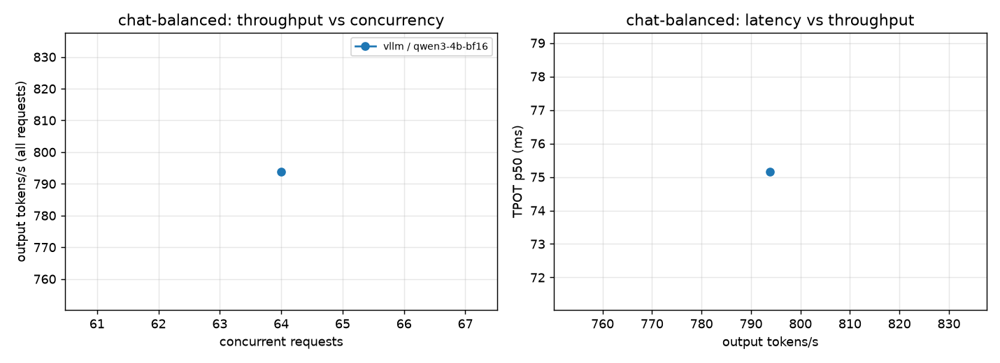

# M2 E8: vLLM memory knobs on L4

Sources: serve/results/e8-l4-vllm-gmu050/20261124T083749Z, serve/results/e8-l4-vllm-gmu070/20261124T084151Z, serve/results/e8-l4-vllm-gmu090/20261124T084409Z, serve/results/e8-l4-vllm-len16384/20261124T084631Z, serve/results/e8-l4-vllm-len2048/20261124T084933Z, serve/results/e8-l4-vllm-seqs128/20261124T085234Z, serve/results/e8-l4-vllm-seqs32/20261124T085534Z, serve/results/e8-l4-vllm-seqs8/20261124T085837Z

| Workload | Artifact | Engine | Conc. | Out tok/s (median [min-max]) | TTFT p50 / p95 (s) | TPOT p50 / p95 (ms) | SLO met | Goodput tok/s | Out tok/req | Peak mem MiB | Reps | Err |
|---|---|---|---|---|---|---|---|---|---|---|---|---|
| chat-balanced | qwen3-4b-bf16 | vllm | 64 | 793.9 [203.9-795.7] | 1.33 / 4.84 | 75 / 77 | 0% | 0.0 | 256 | 20731 | 8 | 0 |

