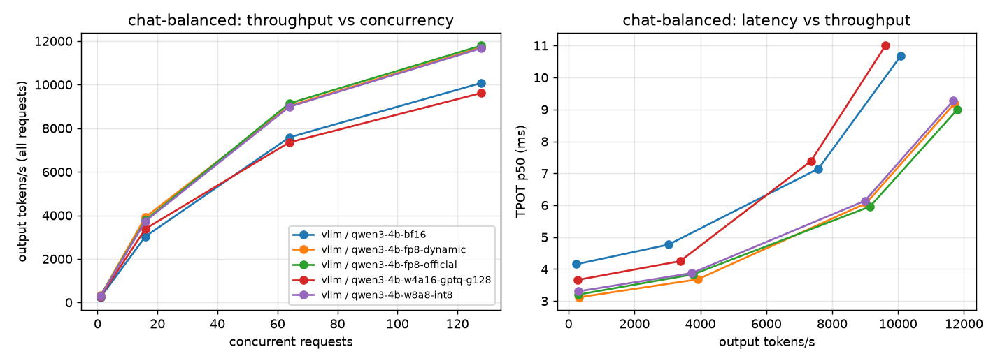

# E2 quantization speed (H100, vLLM)

Sources: serve/results/e2-h100-vllm-bf16/20261124T103317Z, serve/results/e2-h100-vllm-fp8-dynamic/20261124T103641Z, serve/results/e2-h100-vllm-fp8-official/20261124T103943Z, serve/results/e2-h100-vllm-w4a16-gptq/20261124T104532Z, serve/results/e2-h100-vllm-w8a8-int8/20261124T104838Z

| Workload | Artifact | Engine | Conc. | Out tok/s (median [min-max]) | TTFT p50 / p95 (s) | TPOT p50 / p95 (ms) | SLO met | Goodput tok/s | Out tok/req | Peak mem MiB | Reps | Err |
|---|---|---|---|---|---|---|---|---|---|---|---|---|
| chat-balanced | qwen3-4b-bf16 | vllm | 1 | 236.7 [236.6-236.9] | 0.02 / 0.02 | 4 / 4 | 100% | 236.7 | 256 | 73989 | 2 | 0 |
| chat-balanced | qwen3-4b-bf16 | vllm | 16 | 3033.5 [3032.3-3034.8] | 0.12 / 0.16 | 5 / 5 | 100% | 3033.5 | 256 | 73989 | 2 | 0 |
| chat-balanced | qwen3-4b-bf16 | vllm | 64 | 7583.7 [7558.1-7609.3] | 0.31 / 0.51 | 7 / 8 | 92% | 6951.7 | 256 | 73989 | 2 | 0 |
| chat-balanced | qwen3-4b-bf16 | vllm | 128 | 10078.9 [10029.0-10128.9] | 0.49 / 0.93 | 11 / 12 | 52% | 5253.6 | 256 | 73989 | 2 | 0 |
| chat-balanced | qwen3-4b-fp8-dynamic | vllm | 1 | 314.7 [314.5-314.9] | 0.02 / 0.02 | 3 / 3 | 100% | 314.7 | 256 | 73753 | 2 | 0 |
| chat-balanced | qwen3-4b-fp8-dynamic | vllm | 16 | 3920.5 [3920.4-3920.7] | 0.10 / 0.12 | 4 / 4 | 100% | 3920.5 | 256 | 73753 | 2 | 0 |
| chat-balanced | qwen3-4b-fp8-dynamic | vllm | 64 | 9028.5 [8995.6-9061.3] | 0.25 / 0.39 | 6 / 7 | 100% | 9028.5 | 256 | 73753 | 2 | 0 |
| chat-balanced | qwen3-4b-fp8-dynamic | vllm | 128 | 11709.9 [11635.2-11784.6] | 0.45 / 0.73 | 9 / 10 | 60% | 7016.9 | 256 | 73753 | 2 | 0 |
| chat-balanced | qwen3-4b-fp8-official | vllm | 1 | 303.8 [303.4-304.2] | 0.02 / 0.03 | 3 / 3 | 100% | 303.8 | 256 | 73969 | 2 | 0 |
| chat-balanced | qwen3-4b-fp8-official | vllm | 16 | 3781.4 [3778.7-3784.1] | 0.10 / 0.12 | 4 / 4 | 100% | 3781.4 | 256 | 73969 | 2 | 0 |
| chat-balanced | qwen3-4b-fp8-official | vllm | 64 | 9144.4 [9138.1-9150.7] | 0.25 / 0.41 | 6 / 6 | 100% | 9144.4 | 256 | 73969 | 2 | 0 |
| chat-balanced | qwen3-4b-fp8-official | vllm | 128 | 11796.4 [11735.4-11857.4] | 0.47 / 0.78 | 9 / 10 | 55% | 6526.6 | 256 | 73969 | 2 | 0 |
| chat-balanced | qwen3-4b-w4a16-gptq-g128 | vllm | 1 | 268.3 [268.0-268.6] | 0.02 / 0.02 | 4 / 4 | 100% | 268.3 | 256 | 74033 | 2 | 0 |
| chat-balanced | qwen3-4b-w4a16-gptq-g128 | vllm | 16 | 3384.6 [3376.2-3393.1] | 0.13 / 0.15 | 4 / 5 | 100% | 3384.6 | 256 | 74033 | 2 | 0 |
| chat-balanced | qwen3-4b-w4a16-gptq-g128 | vllm | 64 | 7354.5 [7341.4-7367.6] | 0.33 / 0.53 | 7 / 8 | 88% | 6435.7 | 256 | 74033 | 2 | 0 |
| chat-balanced | qwen3-4b-w4a16-gptq-g128 | vllm | 128 | 9618.8 [9594.0-9643.7] | 0.57 / 0.98 | 11 / 13 | 43% | 4158.4 | 256 | 74033 | 2 | 0 |
| chat-balanced | qwen3-4b-w8a8-int8 | vllm | 1 | 297.2 [296.9-297.5] | 0.02 / 0.02 | 3 / 3 | 100% | 297.2 | 256 | 73977 | 2 | 0 |
| chat-balanced | qwen3-4b-w8a8-int8 | vllm | 16 | 3739.6 [3739.5-3739.8] | 0.10 / 0.12 | 4 / 4 | 100% | 3739.6 | 256 | 73977 | 2 | 0 |
| chat-balanced | qwen3-4b-w8a8-int8 | vllm | 64 | 8991.3 [8939.2-9043.4] | 0.24 / 0.40 | 6 / 7 | 100% | 8991.3 | 256 | 73977 | 2 | 0 |
| chat-balanced | qwen3-4b-w8a8-int8 | vllm | 128 | 11672.8 [11646.3-11699.3] | 0.40 / 0.72 | 9 / 10 | 65% | 7569.1 | 256 | 73977 | 2 | 0 |

