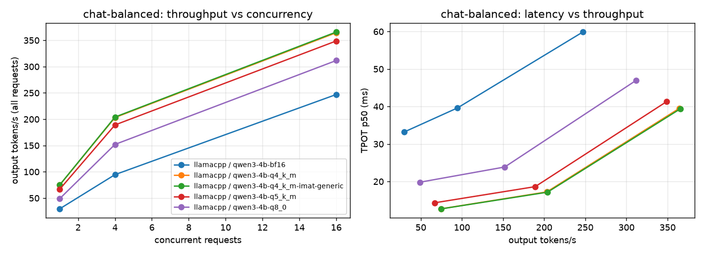

# E2 GGUF speed (L4, llama.cpp)

Sources: serve/results/e2-l4-llamacpp-bf16/20261124T105648Z, serve/results/e2-l4-llamacpp-q4_k_m-imat-generic/20261124T110704Z, serve/results/e2-l4-llamacpp-q4_k_m/20261124T111148Z, serve/results/e2-l4-llamacpp-q5_k_m/20261124T111632Z, serve/results/e2-l4-llamacpp-q8_0/20261124T112141Z

| Workload | Artifact | Engine | Conc. | Out tok/s (median [min-max]) | TTFT p50 / p95 (s) | TPOT p50 / p95 (ms) | SLO met | Goodput tok/s | Out tok/req | Peak mem MiB | Reps | Err |
|---|---|---|---|---|---|---|---|---|---|---|---|---|
| chat-balanced | qwen3-4b-bf16 | llamacpp | 1 | 29.5 [29.5-29.6] | 0.20 / 0.21 | 33 / 33 | 100% | 29.5 | 256 | 17231 | 2 | 0 |
| chat-balanced | qwen3-4b-bf16 | llamacpp | 4 | 94.6 [94.6-94.6] | 0.71 / 0.77 | 40 / 40 | 0% | 0.0 | 256 | 17231 | 2 | 0 |
| chat-balanced | qwen3-4b-bf16 | llamacpp | 16 | 247.0 [246.8-247.2] | 1.34 / 2.38 | 60 / 62 | 0% | 0.0 | 256 | 17231 | 2 | 0 |
| chat-balanced | qwen3-4b-q4_k_m | llamacpp | 1 | 74.7 [74.7-74.7] | 0.17 / 0.18 | 13 / 13 | 100% | 74.7 | 256 | 11923 | 2 | 0 |
| chat-balanced | qwen3-4b-q4_k_m | llamacpp | 4 | 203.2 [201.9-204.5] | 0.64 / 0.67 | 17 / 17 | 0% | 0.0 | 256 | 11923 | 2 | 0 |
| chat-balanced | qwen3-4b-q4_k_m | llamacpp | 16 | 364.5 [361.3-367.8] | 1.17 / 2.05 | 40 / 42 | 0% | 0.0 | 256 | 11923 | 2 | 0 |
| chat-balanced | qwen3-4b-q4_k_m-imat-generic | llamacpp | 1 | 74.9 [74.9-75.0] | 0.17 / 0.18 | 13 / 13 | 100% | 74.9 | 256 | 11923 | 2 | 0 |
| chat-balanced | qwen3-4b-q4_k_m-imat-generic | llamacpp | 4 | 204.1 [203.2-205.0] | 0.64 / 0.67 | 17 / 17 | 0% | 0.0 | 256 | 11923 | 2 | 0 |
| chat-balanced | qwen3-4b-q4_k_m-imat-generic | llamacpp | 16 | 365.8 [365.3-366.3] | 1.17 / 2.05 | 39 / 42 | 0% | 0.0 | 256 | 11923 | 2 | 0 |
| chat-balanced | qwen3-4b-q5_k_m | llamacpp | 1 | 66.7 [66.6-66.8] | 0.18 / 0.19 | 14 / 14 | 100% | 66.7 | 256 | 12297 | 2 | 0 |
| chat-balanced | qwen3-4b-q5_k_m | llamacpp | 4 | 189.1 [189.0-189.2] | 0.66 / 0.69 | 19 / 19 | 0% | 0.0 | 256 | 12297 | 2 | 0 |
| chat-balanced | qwen3-4b-q5_k_m | llamacpp | 16 | 348.8 [347.9-349.7] | 1.22 / 2.13 | 41 / 44 | 0% | 0.0 | 256 | 12297 | 2 | 0 |
| chat-balanced | qwen3-4b-q8_0 | llamacpp | 1 | 48.8 [48.6-49.0] | 0.18 / 0.21 | 20 / 20 | 100% | 48.8 | 256 | 13623 | 2 | 0 |
| chat-balanced | qwen3-4b-q8_0 | llamacpp | 4 | 152.1 [151.7-152.4] | 0.64 / 0.68 | 24 / 24 | 0% | 0.0 | 256 | 13623 | 2 | 0 |
| chat-balanced | qwen3-4b-q8_0 | llamacpp | 16 | 311.6 [311.2-312.0] | 1.19 / 2.05 | 47 / 49 | 0% | 0.0 | 256 | 13623 | 2 | 0 |

