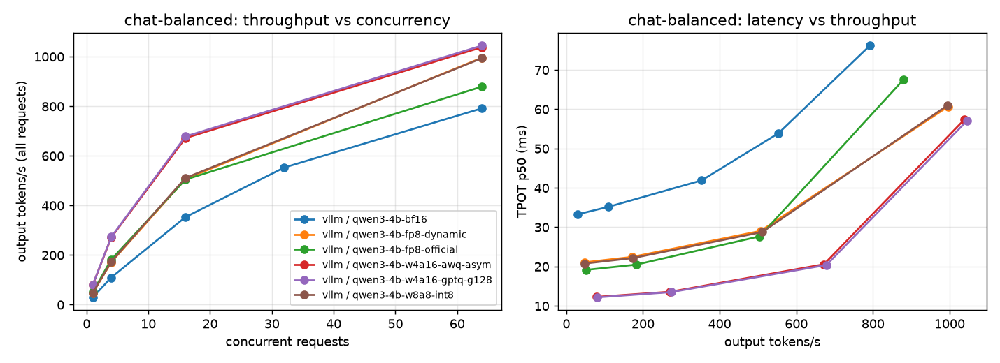
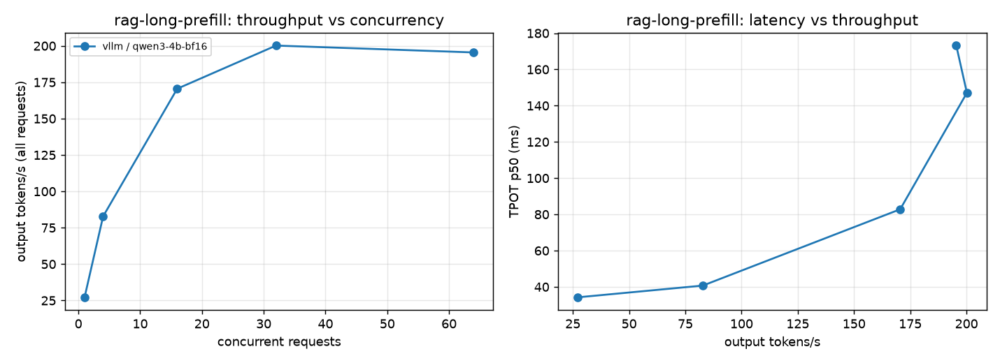

# E2 quantization speed (L4, vLLM)

Sources: serve/results/e2-l4-vllm-fp8-dynamic/20261124T111538Z, serve/results/e2-l4-vllm-fp8-official/20261124T111645Z, serve/results/e2-l4-vllm-w4a16-awq/20261124T111332Z, serve/results/e2-l4-vllm-w4a16-gptq/20261124T111658Z, serve/results/e2-l4-vllm-w8a8-int8/20261124T112233Z, serve/results/e1-l4-vllm/20261124T064135Z

| Workload | Artifact | Engine | Conc. | Out tok/s (median [min-max]) | TTFT p50 / p95 (s) | TPOT p50 / p95 (ms) | SLO met | Goodput tok/s | Out tok/req | Peak mem MiB | Reps | Err |
|---|---|---|---|---|---|---|---|---|---|---|---|---|
| chat-balanced | qwen3-4b-bf16 | vllm | 1 | 29.8 [29.8-29.8] | 0.10 / 0.11 | 33 / 33 | 100% | 29.8 | 256 | 20163 | 3 | 0 |
| chat-balanced | qwen3-4b-bf16 | vllm | 4 | 109.7 [109.7-109.8] | 0.36 / 0.37 | 35 / 36 | 100% | 109.7 | 256 | 20163 | 3 | 0 |
| chat-balanced | qwen3-4b-bf16 | vllm | 16 | 353.2 [353.1-353.4] | 0.83 / 1.30 | 42 / 44 | 25% | 88.3 | 256 | 20163 | 3 | 0 |
| chat-balanced | qwen3-4b-bf16 | vllm | 32 | 553.3 [552.3-556.5] | 0.94 / 2.28 | 54 / 56 | 0% | 0.0 | 256 | 20163 | 3 | 0 |
| chat-balanced | qwen3-4b-bf16 | vllm | 64 | 792.0 [788.8-795.5] | 1.04 / 4.61 | 76 / 78 | 0% | 0.0 | 256 | 20163 | 3 | 0 |
| chat-balanced | qwen3-4b-fp8-dynamic | vllm | 1 | 47.0 [46.8-47.2] | 0.07 / 0.07 | 21 / 21 | 100% | 47.0 | 256 | 20145 | 2 | 0 |
| chat-balanced | qwen3-4b-fp8-dynamic | vllm | 4 | 171.5 [170.9-172.0] | 0.25 / 0.26 | 22 / 23 | 100% | 171.5 | 256 | 20145 | 2 | 0 |
| chat-balanced | qwen3-4b-fp8-dynamic | vllm | 16 | 506.9 [503.5-510.3] | 0.60 / 0.99 | 29 / 31 | 35% | 179.6 | 256 | 20145 | 2 | 0 |
| chat-balanced | qwen3-4b-fp8-dynamic | vllm | 64 | 996.0 [990.0-1002.1] | 0.83 / 3.61 | 61 / 62 | 0% | 0.0 | 256 | 20145 | 2 | 0 |
| chat-balanced | qwen3-4b-fp8-official | vllm | 1 | 51.3 [51.1-51.4] | 0.11 / 0.11 | 19 / 19 | 100% | 51.3 | 256 | 20200 | 2 | 0 |
| chat-balanced | qwen3-4b-fp8-official | vllm | 4 | 182.1 [181.8-182.5] | 0.40 / 0.41 | 20 / 22 | 100% | 182.1 | 256 | 20200 | 2 | 0 |
| chat-balanced | qwen3-4b-fp8-official | vllm | 16 | 504.7 [503.8-505.6] | 0.95 / 1.55 | 28 / 31 | 25% | 126.2 | 256 | 20200 | 2 | 0 |
| chat-balanced | qwen3-4b-fp8-official | vllm | 64 | 879.5 [877.5-881.5] | 1.26 / 5.58 | 68 / 70 | 0% | 0.0 | 256 | 20200 | 2 | 0 |
| chat-balanced | qwen3-4b-w4a16-awq-asym | vllm | 1 | 79.5 [79.3-79.7] | 0.08 / 0.09 | 12 / 12 | 100% | 79.5 | 256 | 20197 | 2 | 0 |
| chat-balanced | qwen3-4b-w4a16-awq-asym | vllm | 4 | 271.0 [270.3-271.7] | 0.31 / 0.32 | 14 / 14 | 100% | 271.0 | 256 | 20197 | 2 | 0 |
| chat-balanced | qwen3-4b-w4a16-awq-asym | vllm | 16 | 672.0 [670.9-673.2] | 0.77 / 1.25 | 21 / 23 | 25% | 168.0 | 256 | 20197 | 2 | 0 |
| chat-balanced | qwen3-4b-w4a16-awq-asym | vllm | 64 | 1038.4 [1038.4-1038.4] | 1.05 / 4.55 | 57 / 59 | 0% | 0.0 | 256 | 20197 | 2 | 0 |
| chat-balanced | qwen3-4b-w4a16-gptq-g128 | vllm | 1 | 80.3 [80.0-80.6] | 0.08 / 0.08 | 12 / 12 | 100% | 80.3 | 256 | 20216 | 2 | 0 |
| chat-balanced | qwen3-4b-w4a16-gptq-g128 | vllm | 4 | 273.1 [272.1-274.1] | 0.31 / 0.32 | 13 / 14 | 100% | 273.1 | 256 | 20216 | 2 | 0 |
| chat-balanced | qwen3-4b-w4a16-gptq-g128 | vllm | 16 | 678.7 [676.6-680.7] | 0.76 / 1.23 | 20 / 23 | 25% | 169.7 | 256 | 20216 | 2 | 0 |
| chat-balanced | qwen3-4b-w4a16-gptq-g128 | vllm | 64 | 1045.1 [1040.6-1049.6] | 1.04 / 4.50 | 57 / 59 | 0% | 0.0 | 256 | 20216 | 2 | 0 |
| chat-balanced | qwen3-4b-w8a8-int8 | vllm | 1 | 47.7 [47.6-47.7] | 0.08 / 0.08 | 21 / 21 | 100% | 47.7 | 256 | 20219 | 2 | 0 |
| chat-balanced | qwen3-4b-w8a8-int8 | vllm | 4 | 173.3 [173.1-173.4] | 0.26 / 0.27 | 22 / 23 | 100% | 173.3 | 256 | 20219 | 2 | 0 |
| chat-balanced | qwen3-4b-w8a8-int8 | vllm | 16 | 511.2 [511.0-511.4] | 0.60 / 0.98 | 29 / 31 | 38% | 191.7 | 256 | 20219 | 2 | 0 |
| chat-balanced | qwen3-4b-w8a8-int8 | vllm | 64 | 994.1 [993.7-994.5] | 0.83 / 3.54 | 61 / 62 | 0% | 0.0 | 256 | 20219 | 2 | 0 |
| rag-long-prefill | qwen3-4b-bf16 | vllm | 1 | 27.2 [27.2-27.2] | 0.36 / 0.37 | 34 / 34 | 100% | 27.2 | 128 | 20163 | 3 | 0 |
| rag-long-prefill | qwen3-4b-bf16 | vllm | 4 | 82.8 [82.4-83.4] | 1.00 / 1.32 | 41 / 43 | 0% | 0.0 | 128 | 20163 | 3 | 0 |
| rag-long-prefill | qwen3-4b-bf16 | vllm | 16 | 170.5 [168.7-171.8] | 1.36 / 4.80 | 83 / 86 | 0% | 0.0 | 128 | 20163 | 3 | 0 |
| rag-long-prefill | qwen3-4b-bf16 | vllm | 32 | 200.2 [199.1-201.1] | 1.59 / 9.91 | 147 / 149 | 0% | 0.0 | 128 | 20163 | 3 | 0 |
| rag-long-prefill | qwen3-4b-bf16 | vllm | 64 | 195.5 [194.6-195.8] | 21.16 / 29.44 | 173 / 175 | 0% | 0.0 | 128 | 20163 | 3 | 0 |

