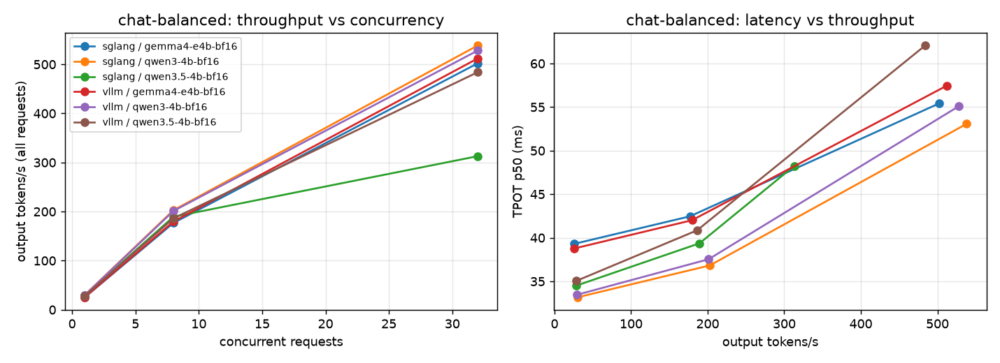
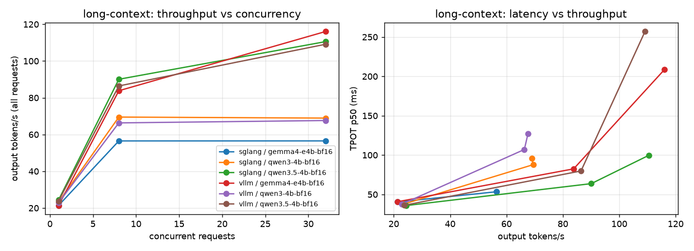

# E15 architecture study (L4, 8K)

Sources: serve/results/e15-l4-sglang-gemma4-e4b-8k/20261124T113008Z, serve/results/e15-l4-sglang-qwen3-4b-8k/20261124T120218Z, serve/results/e15-l4-sglang-qwen3.5-4b-8k/20261124T114800Z, serve/results/e15-l4-vllm-gemma4-e4b-8k/20261124T113518Z, serve/results/e15-l4-vllm-qwen3-4b-8k/20261124T121824Z, serve/results/e15-l4-vllm-qwen3.5-4b-8k/20261124T115831Z

| Workload | Artifact | Engine | Conc. | Out tok/s (median [min-max]) | TTFT p50 / p95 (s) | TPOT p50 / p95 (ms) | SLO met | Goodput tok/s | Out tok/req | Peak mem MiB | Reps | Err |
|---|---|---|---|---|---|---|---|---|---|---|---|---|
| chat-balanced | gemma4-e4b-bf16 | sglang | 1 | 25.2 [25.2-25.2] | 0.13 / 0.13 | 39 / 39 | 100% | 25.2 | 256 | 20400 | 1 | 0 |
| chat-balanced | gemma4-e4b-bf16 | vllm | 1 | 25.6 [25.6-25.6] | 0.13 / 0.13 | 39 / 39 | 100% | 25.6 | 256 | 20569 | 1 | 0 |
| chat-balanced | gemma4-e4b-bf16 | sglang | 8 | 176.8 [176.8-176.8] | 0.79 / 0.79 | 42 / 45 | 12% | 22.1 | 256 | 20400 | 1 | 0 |
| chat-balanced | gemma4-e4b-bf16 | vllm | 8 | 179.6 [179.6-179.6] | 0.65 / 0.82 | 42 / 44 | 31% | 56.1 | 256 | 20853 | 1 | 0 |
| chat-balanced | gemma4-e4b-bf16 | sglang | 32 | 502.0 [502.0-502.0] | 2.18 / 3.32 | 55 / 60 | 0% | 0.0 | 256 | 20640 | 1 | 0 |
| chat-balanced | gemma4-e4b-bf16 | vllm | 32 | 511.9 [511.9-511.9] | 1.14 / 3.10 | 57 / 60 | 0% | 0.0 | 256 | 20853 | 1 | 0 |
| chat-balanced | qwen3-4b-bf16 | sglang | 1 | 29.9 [29.9-29.9] | 0.11 / 0.11 | 33 / 33 | 100% | 29.9 | 256 | 21041 | 1 | 0 |
| chat-balanced | qwen3-4b-bf16 | vllm | 1 | 29.6 [29.6-29.6] | 0.11 / 0.12 | 33 / 34 | 100% | 29.6 | 256 | 19903 | 1 | 0 |
| chat-balanced | qwen3-4b-bf16 | vllm | 8 | 201.2 [201.2-201.2] | 0.60 / 0.76 | 38 / 39 | 50% | 100.6 | 256 | 20143 | 1 | 0 |
| chat-balanced | qwen3-4b-bf16 | sglang | 8 | 202.8 [202.8-202.8] | 0.71 / 0.71 | 37 / 39 | 12% | 25.3 | 256 | 21203 | 1 | 0 |
| chat-balanced | qwen3-4b-bf16 | vllm | 32 | 528.0 [528.0-528.0] | 1.25 / 3.30 | 55 / 58 | 0% | 0.0 | 256 | 20143 | 1 | 0 |
| chat-balanced | qwen3-4b-bf16 | sglang | 32 | 538.3 [538.3-538.3] | 1.66 / 2.67 | 53 / 58 | 0% | 0.0 | 256 | 21331 | 1 | 0 |
| chat-balanced | qwen3.5-4b-bf16 | sglang | 1 | 28.7 [28.7-28.7] | 0.12 / 0.14 | 35 / 35 | 100% | 28.7 | 256 | 20980 | 1 | 0 |
| chat-balanced | qwen3.5-4b-bf16 | vllm | 1 | 28.2 [28.2-28.2] | 0.13 / 0.13 | 35 / 35 | 100% | 28.2 | 256 | 19397 | 1 | 0 |
| chat-balanced | qwen3.5-4b-bf16 | sglang | 8 | 189.4 [189.4-189.4] | 0.76 / 0.79 | 39 / 42 | 12% | 23.7 | 256 | 21362 | 1 | 0 |
| chat-balanced | qwen3.5-4b-bf16 | vllm | 8 | 186.1 [186.1-186.1] | 0.56 / 0.76 | 41 / 42 | 50% | 93.1 | 256 | 19643 | 1 | 0 |
| chat-balanced | qwen3.5-4b-bf16 | vllm | 32 | 483.9 [483.9-483.9] | 0.93 / 3.14 | 62 / 64 | 0% | 0.0 | 256 | 19703 | 1 | 0 |
| chat-balanced | qwen3.5-4b-bf16 | sglang | 32 | 312.8 [312.8-312.8] | 14.34 / 15.35 | 48 / 52 | 0% | 0.0 | 256 | 21564 | 1 | 0 |
| long-context | gemma4-e4b-bf16 | sglang | 1 | 21.4 [21.4-21.4] | 1.67 / 1.68 | 40 / 40 | 0% | 0.0 | 256 | 20640 | 1 | 0 |
| long-context | gemma4-e4b-bf16 | vllm | 1 | 21.3 [21.3-21.3] | 1.63 / 1.66 | 41 / 41 | 0% | 0.0 | 256 | 20853 | 1 | 0 |
| long-context | gemma4-e4b-bf16 | sglang | 8 | 56.5 [56.5-56.5] | 21.71 / 24.84 | 53 / 64 | 0% | 0.0 | 256 | 20640 | 1 | 0 |
| long-context | gemma4-e4b-bf16 | vllm | 8 | 83.8 [83.8-83.8] | 2.97 / 11.69 | 82 / 87 | 0% | 0.0 | 256 | 20853 | 1 | 0 |
| long-context | gemma4-e4b-bf16 | sglang | 32 | 56.5 [56.5-56.5] | 128.54 / 133.43 | 53 / 64 | 0% | 0.0 | 256 | 20640 | 1 | 0 |
| long-context | gemma4-e4b-bf16 | vllm | 32 | 116.1 [116.1-116.1] | 11.03 / 56.37 | 209 / 219 | 0% | 0.0 | 256 | 20853 | 1 | 0 |
| long-context | qwen3-4b-bf16 | vllm | 1 | 22.9 [22.9-22.9] | 1.60 / 1.63 | 38 / 38 | 0% | 0.0 | 256 | 20143 | 1 | 0 |
| long-context | qwen3-4b-bf16 | sglang | 1 | 23.2 [23.2-23.2] | 1.52 / 1.53 | 37 / 37 | 0% | 0.0 | 256 | 21331 | 1 | 0 |
| long-context | qwen3-4b-bf16 | sglang | 8 | 69.5 [69.5-69.5] | 7.06 / 11.87 | 88 / 109 | 0% | 0.0 | 256 | 21331 | 1 | 0 |
| long-context | qwen3-4b-bf16 | vllm | 8 | 66.3 [66.3-66.3] | 3.36 / 12.38 | 107 / 110 | 0% | 0.0 | 256 | 20145 | 1 | 0 |
| long-context | qwen3-4b-bf16 | sglang | 32 | 68.9 [68.9-68.9] | 75.90 / 104.73 | 96 / 121 | 0% | 0.0 | 256 | 21331 | 1 | 0 |
| long-context | qwen3-4b-bf16 | vllm | 32 | 67.6 [67.6-67.6] | 81.95 / 100.29 | 127 / 150 | 0% | 0.0 | 256 | 20145 | 1 | 0 |
| long-context | qwen3.5-4b-bf16 | sglang | 1 | 24.3 [24.3-24.3] | 1.39 / 1.40 | 36 / 36 | 0% | 0.0 | 256 | 21564 | 1 | 0 |
| long-context | qwen3.5-4b-bf16 | vllm | 1 | 23.8 [23.8-23.8] | 1.52 / 1.55 | 36 / 36 | 0% | 0.0 | 256 | 19703 | 1 | 0 |
| long-context | qwen3.5-4b-bf16 | vllm | 8 | 86.4 [86.4-86.4] | 3.03 / 11.37 | 80 / 82 | 0% | 0.0 | 256 | 19771 | 1 | 0 |
| long-context | qwen3.5-4b-bf16 | sglang | 8 | 90.1 [90.1-90.1] | 6.49 / 10.82 | 64 / 83 | 0% | 0.0 | 256 | 21564 | 1 | 0 |
| long-context | qwen3.5-4b-bf16 | sglang | 32 | 110.6 [110.6-110.6] | 44.27 / 58.22 | 100 / 149 | 0% | 0.0 | 256 | 21564 | 1 | 0 |
| long-context | qwen3.5-4b-bf16 | vllm | 32 | 109.1 [109.1-109.1] | 4.00 / 50.37 | 257 / 282 | 0% | 0.0 | 256 | 19771 | 1 | 0 |

