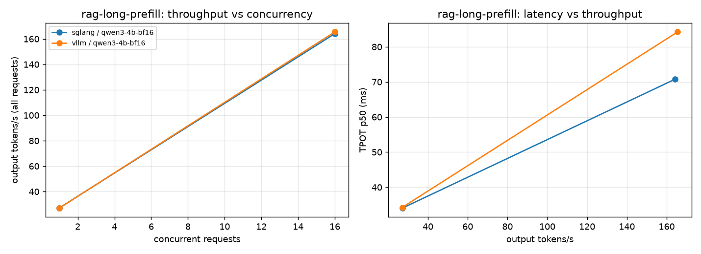
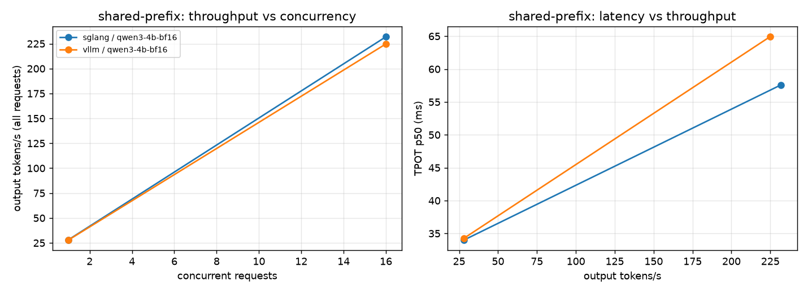

# E4 prefix caching (L4)

Sources: serve/results/e4-l4-sglang-radix-off/20261124T114041Z, serve/results/e4-l4-sglang-radix-on/20261124T114910Z, serve/results/e4-l4-vllm-apc-off/20261124T113553Z, serve/results/e4-l4-vllm-apc-on/20261124T114517Z

| Workload | Artifact | Engine | Conc. | Out tok/s (median [min-max]) | TTFT p50 / p95 (s) | TPOT p50 / p95 (ms) | SLO met | Goodput tok/s | Out tok/req | Peak mem MiB | Reps | Err |
|---|---|---|---|---|---|---|---|---|---|---|---|---|
| rag-long-prefill | qwen3-4b-bf16 | sglang | 1 | 27.2 [27.2-27.3] | 0.38 / 0.38 | 34 / 34 | 100% | 27.2 | 128 | 21149 | 4 | 0 |
| rag-long-prefill | qwen3-4b-bf16 | vllm | 1 | 27.1 [27.1-27.1] | 0.38 / 0.38 | 34 / 34 | 100% | 27.1 | 128 | 20704 | 4 | 0 |
| rag-long-prefill | qwen3-4b-bf16 | vllm | 16 | 165.5 [165.2-166.0] | 1.43 / 5.33 | 84 / 88 | 0% | 0.0 | 128 | 20704 | 4 | 0 |
| rag-long-prefill | qwen3-4b-bf16 | sglang | 16 | 164.2 [163.1-165.1] | 3.49 / 5.57 | 71 / 92 | 0% | 0.0 | 128 | 21149 | 4 | 0 |
| shared-prefix | qwen3-4b-bf16 | vllm | 1 | 27.9 [27.1-28.6] | 0.24 / 0.25 | 34 / 34 | 100% | 27.9 | 128 | 20704 | 4 | 0 |
| shared-prefix | qwen3-4b-bf16 | sglang | 1 | 28.2 [27.4-28.9] | 0.23 / 0.24 | 34 / 34 | 100% | 28.2 | 128 | 21149 | 4 | 0 |
| shared-prefix | qwen3-4b-bf16 | sglang | 16 | 231.9 [166.8-295.9] | 2.23 / 3.39 | 58 / 70 | 0% | 0.0 | 128 | 21149 | 4 | 0 |
| shared-prefix | qwen3-4b-bf16 | vllm | 16 | 224.8 [164.8-285.3] | 1.24 / 3.40 | 65 / 71 | 0% | 0.0 | 128 | 20704 | 4 | 0 |

