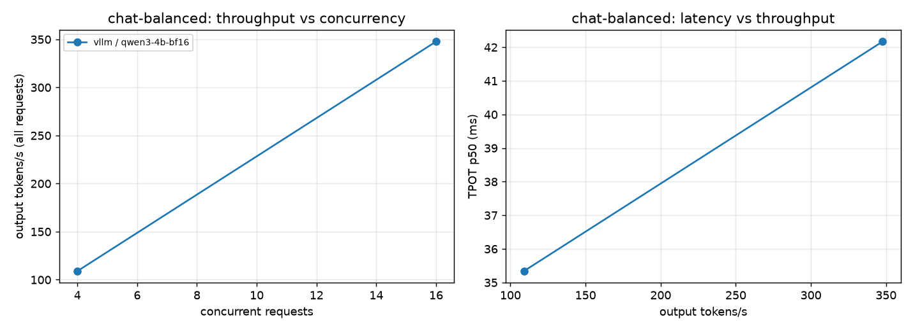
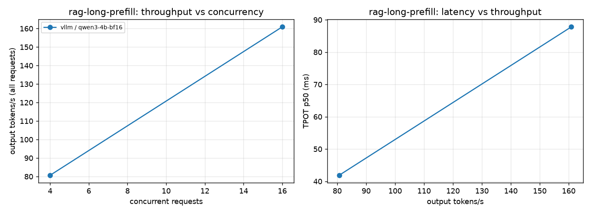

# E5 chunked prefill (L4)

Sources: serve/results/e5-l4-vllm-chunked-off/20261124T112707Z, serve/results/e5-l4-vllm-chunked-on/20261124T113419Z

| Workload | Artifact | Engine | Conc. | Out tok/s (median [min-max]) | TTFT p50 / p95 (s) | TPOT p50 / p95 (ms) | SLO met | Goodput tok/s | Out tok/req | Peak mem MiB | Reps | Err |
|---|---|---|---|---|---|---|---|---|---|---|---|---|
| chat-balanced | qwen3-4b-bf16 | vllm | 4 | 109.0 [108.8-109.1] | 0.38 / 0.39 | 35 / 36 | 100% | 109.0 | 256 | 20331 | 4 | 0 |
| chat-balanced | qwen3-4b-bf16 | vllm | 16 | 347.7 [347.0-348.8] | 0.96 / 1.34 | 42 / 44 | 16% | 54.4 | 256 | 20331 | 4 | 0 |
| rag-long-prefill | qwen3-4b-bf16 | vllm | 4 | 80.7 [79.5-81.6] | 1.01 / 1.39 | 42 / 45 | 12% | 9.9 | 128 | 20127 | 4 | 0 |
| rag-long-prefill | qwen3-4b-bf16 | vllm | 16 | 160.9 [159.1-163.5] | 1.33 / 5.50 | 88 / 91 | 0% | 0.0 | 128 | 20127 | 4 | 0 |

