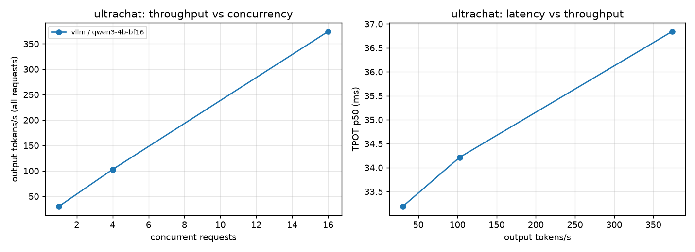

# E6 speculative decoding (L4, real prompts)

Sources: serve/results/e6-l4-vllm-baseline/20261124T112833Z, serve/results/e6-l4-vllm-draft06b/20261124T113614Z, serve/results/e6-l4-vllm-ngram/20261124T114343Z

| Workload | Artifact | Engine | Conc. | Out tok/s (median [min-max]) | TTFT p50 / p95 (s) | TPOT p50 / p95 (ms) | SLO met | Goodput tok/s | Out tok/req | Peak mem MiB | Reps | Err |
|---|---|---|---|---|---|---|---|---|---|---|---|---|
| ultrachat | qwen3-4b-bf16 | vllm | 1 | 30.2 [29.7-38.6] | 0.05 / 0.15 | 33 / 33 | 100% | 30.2 | 244 | 20153 | 6 | 0 |
| ultrachat | qwen3-4b-bf16 | vllm | 4 | 102.9 [92.5-120.3] | 0.14 / 0.20 | 34 / 35 | 100% | 102.9 | 225 | 20153 | 6 | 0 |
| ultrachat | qwen3-4b-bf16 | vllm | 16 | 374.0 [323.3-407.6] | 0.35 / 0.43 | 37 / 43 | 100% | 336.6 | 242 | 20229 | 6 | 0 |

