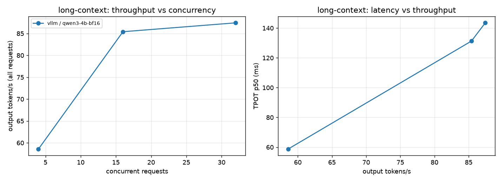

# E7 FP8 KV cache (L4, long context)

Sources: serve/results/e7-l4-vllm-kv-auto/20261124T114914Z, serve/results/e7-l4-vllm-kv-fp8/20261124T120651Z

| Workload | Artifact | Engine | Conc. | Out tok/s (median [min-max]) | TTFT p50 / p95 (s) | TPOT p50 / p95 (ms) | SLO met | Goodput tok/s | Out tok/req | Peak mem MiB | Reps | Err |
|---|---|---|---|---|---|---|---|---|---|---|---|---|
| long-context | qwen3-4b-bf16 | vllm | 4 | 58.6 [53.8-63.2] | 2.24 / 5.28 | 59 / 62 | 0% | 0.0 | 256 | 20450 | 4 | 0 |
| long-context | qwen3-4b-bf16 | vllm | 16 | 85.4 [68.5-102.1] | 9.66 / 30.94 | 131 / 140 | 0% | 0.0 | 256 | 20450 | 4 | 0 |
| long-context | qwen3-4b-bf16 | vllm | 32 | 87.4 [70.7-104.5] | 57.46 / 77.33 | 144 / 155 | 0% | 0.0 | 256 | 20450 | 4 | 0 |

