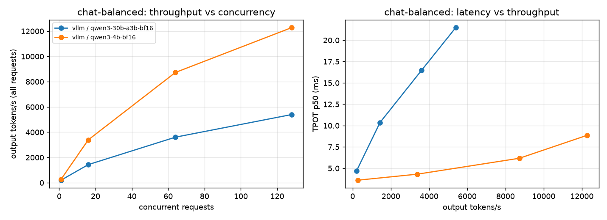

# E9 MoE and E12 TP=2 vs Qwen3-4B on H100

Sources: serve/results/e9-h100-vllm-qwen3-30b-a3b/20261124T112604Z, serve/results/e2-h100-vllm-bf16/20261124T103317Z, serve/results/e12-h100x2-vllm-tp2/20261124T131137Z

| Workload | Artifact | Engine | Conc. | Out tok/s (median [min-max]) | TTFT p50 / p95 (s) | TPOT p50 / p95 (ms) | SLO met | Goodput tok/s | Out tok/req | Peak mem MiB | Reps | Err |
|---|---|---|---|---|---|---|---|---|---|---|---|---|
| chat-balanced | qwen3-30b-a3b-bf16 | vllm | 1 | 201.4 [195.0-207.7] | 0.06 / 0.06 | 5 / 5 | 100% | 201.4 | 256 | 73511 | 2 | 0 |
| chat-balanced | qwen3-30b-a3b-bf16 | vllm | 16 | 1433.1 [1422.3-1443.8] | 0.18 / 0.22 | 10 / 11 | 100% | 1433.1 | 256 | 73511 | 2 | 0 |
| chat-balanced | qwen3-30b-a3b-bf16 | vllm | 64 | 3607.0 [3521.6-3692.4] | 0.33 / 0.68 | 16 / 17 | 79% | 2859.1 | 256 | 73511 | 2 | 0 |
| chat-balanced | qwen3-30b-a3b-bf16 | vllm | 128 | 5397.6 [5391.6-5403.6] | 0.50 / 1.23 | 21 / 22 | 48% | 2593.6 | 256 | 73513 | 2 | 0 |
| chat-balanced | qwen3-4b-bf16 | vllm | 1 | 264.8 [236.6-317.7] | 0.03 / 0.03 | 4 / 4 | 100% | 264.8 | 256 | 74491 | 4 | 0 |
| chat-balanced | qwen3-4b-bf16 | vllm | 16 | 3392.6 [3032.3-4014.8] | 0.12 / 0.14 | 4 / 5 | 100% | 3392.6 | 256 | 74491 | 4 | 0 |
| chat-balanced | qwen3-4b-bf16 | vllm | 64 | 8730.4 [7558.1-10636.5] | 0.29 / 0.45 | 6 / 7 | 96% | 8413.3 | 256 | 74491 | 4 | 0 |
| chat-balanced | qwen3-4b-bf16 | vllm | 128 | 12279.3 [10029.0-14435.9] | 0.46 / 0.79 | 9 / 10 | 56% | 6969.5 | 256 | 74491 | 4 | 0 |

