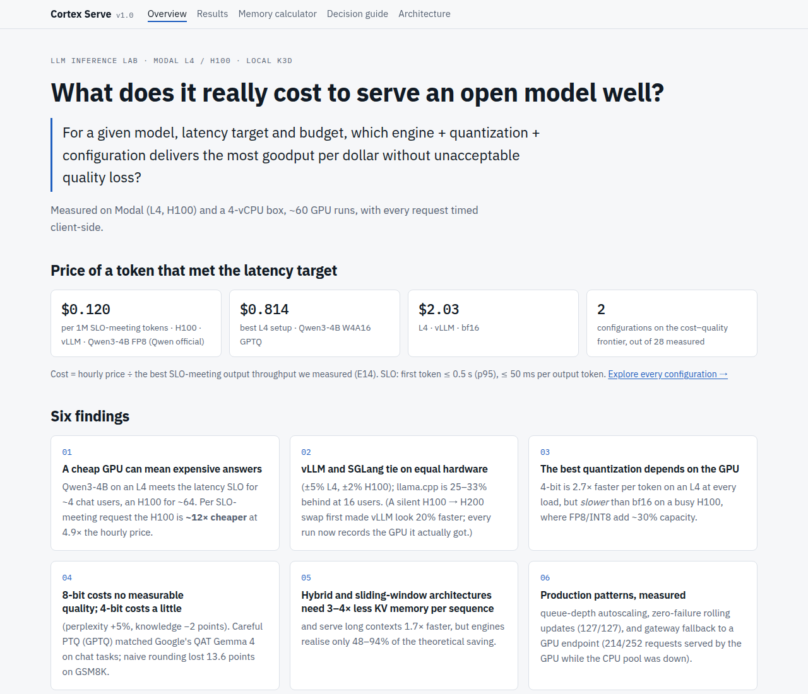
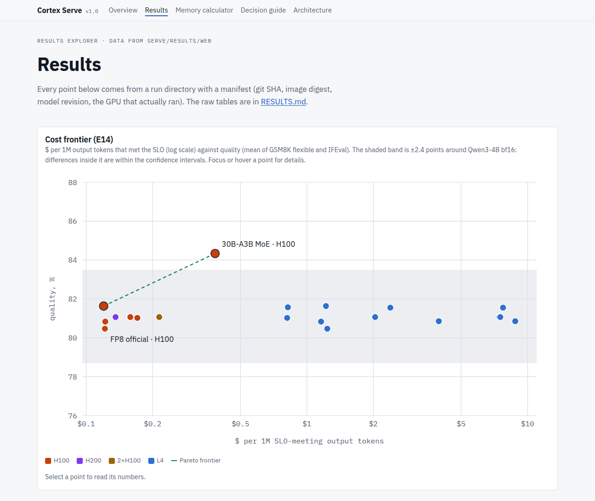
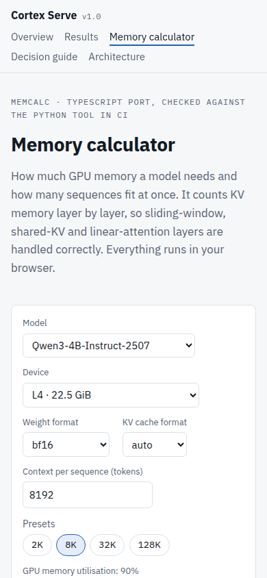

# Cortex Serve web site

A static site that presents the Cortex Serve measurements: the cost–quality frontier, throughput and latency
curves for every configuration, a memory calculator that runs in the browser, the decision guide and the
architecture. Every number is read from files committed in this repository at build time; nothing is fetched
at runtime.

**Live:** https://intragalactic-stranger.github.io/cortex/



| Page | What it shows | Data source |
|---|---|---|
| `/` | The question, the headline prices, the six findings | `README.md` ("Cortex Serve in one screen"), `serve/results/web/configs.json` |
| `/results/` | Cost frontier (E14), throughput/latency curves by GPU and engine, all configurations by cost, quality by variant | `serve/results/web/{configs,curves,quality,frontier}.json` |
| `/memcalc/` | Weights, KV cache per layer type, sequences that fit, decode ceiling; paste any `config.json` | TypeScript port of `serve/src/cortex_serve/memcalc`, device table and model presets from the repo |
| `/guide/` | `serve/docs/DECISION_GUIDE.md`, with its Mermaid flowchart drawn as SVG at build time | the Markdown file |
| `/architecture/` | How the lab and the serving stack fit together | this repo |

<p>
  
  
</p>

## Run it

Needs Node 22 or newer.

```bash
cd web
npm ci
npm run dev          # http://localhost:3000
npm test             # memcalc parity, golden cases, markdown and flowchart tests
npm run typecheck
npm run build        # static export to web/out
npm start            # serve web/out with compression, as a host would
```

From the repository root the same steps are `make web-setup web-test web-build`.

## How it is built

- **Next.js 16 App Router with `output: "export"`**, TypeScript strict, React 19. Pages are server components
  that read the repository's files during the build (`src/lib/data.ts`); only the interactive parts (calculator,
  chart explorers, sortable table, nav) ship JavaScript.
- **Charts are hand-written SVG** with titles and descriptions for screen readers, keyboard-focusable points,
  and a text readout. No chart library.
- **Mermaid without Mermaid.** `src/lib/flowchart.ts` parses the flowchart subset our docs use, lays it out in
  layers and writes static SVG, plus a text outline of the same graph. Unsupported diagrams fall back to the
  source as a code block.
- **memcalc in TypeScript.** `src/lib/memcalc/` mirrors the Python package module by module. Two test suites keep
  them identical: `test/golden.test.ts` runs the hand-calculated cases in `serve/tests/fixtures/golden.json`, and
  `test/vectors.test.ts` replays 192 full estimates and every fixture model's per-layer spec exported by
  `serve/scripts/memcalc_web_vectors.py`. CI regenerates the vectors from Python and fails if they changed
  without being committed.
- Fonts: IBM Plex Sans and Mono via `next/font` (self-hosted at build time). Light and dark themes follow the
  system setting.

## Updating the data

```bash
uv run python serve/scripts/e14_frontier.py          # rewrites serve/results/web/*.json from the run directories
uv run python serve/scripts/memcalc_web_vectors.py   # after any change to the Python memcalc
make web-test web-build
```

## Hosting

The build is plain files in `web/out`, so any static host works.

- **Vercel:** set the project root to `web/`; the default Next.js settings build the static export.
- **GitHub Pages (how this repo is published):** `.github/workflows/pages.yml` builds with `BASE_PATH=/cortex` on every push to `main` that touches the site or its data.

Lighthouse scores and how they were measured: [`LIGHTHOUSE.md`](LIGHTHOUSE.md).
